# Laporan Pengujian Manual SIMONKEB

> Dokumen ini dibuat otomatis oleh `scripts/pengujian-manual.mjs` pada 8 November 2026. Setiap langkah dijalankan di peramban sungguhan (bukan simulasi) dan tangkapan layar diambil setelah langkah selesai.

## Ringkasan

| Item | Nilai |
| --- | --- |
| Aplikasi | SIMONKEB (Laravel 12, PHP 8.3, Inertia v2, Vue 3) |
| Lingkungan | Lokal, SQLite khusus uji, http://127.0.0.1:8123 |
| Data awal | `php artisan migrate:fresh --seed` (8 akun, 4 instansi, 68 unit, 21 jabatan, ±1.080 pegawai, 380 ABK, 4 usulan) |
| Jumlah skenario | 70 |
| Lulus | 70 |
| Temuan (perilaku aplikasi yang perlu diperbaiki) | 0 |
| Gagal (kegagalan pengujian) | 0 |

### Akun demo (password semua: `password`)

| Peran | Email | Keterangan |
| --- | --- | --- |
| admin | `admin@simonkeb.test` | Administrator |
| bkn | `bkn@simonkeb.test` | Verifikator BKN |
| kemenpan | `kemenpan@simonkeb.test` | Validator Kemenpan |
| pimpinan | `pimpinan@simonkeb.test` | Pimpinan (hanya baca) |
| kab | `kab-sjt@simonkeb.test` | Operator Pemerintah Kabupaten Sejahtera |
| kot | `kot-mdn@simonkeb.test` | Operator Kota Madani |
| prov | `prov-nsn@simonkeb.test` | Operator Provinsi Nusantara |
| kl | `kl-adm@simonkeb.test` | Operator Kementerian |

### Cara menjalankan ulang

```bash
# 1. database uji sekali pakai (jangan memakai data yang sedang dipakai orang lain)
export DB_DATABASE=/path/ke/uji.sqlite
php artisan migrate:fresh --seed --force

# 2. server pada port berbeda, dari folder public
cd public && php -d memory_limit=768M -S 127.0.0.1:8123 ../vendor/laravel/framework/src/Illuminate/Foundation/resources/server.php

# 3. jalankan pengujian (jendela peramban terpisah milik Playwright)
APP_URL=http://127.0.0.1:8123 PW_CHROMIUM="C:/Program Files/Google/Chrome/Application/chrome.exe" node scripts/pengujian-manual.mjs
```

> Catatan lingkungan: dompdf membutuhkan memori lebih dari 128 MB untuk laporan ABK, jadi server dijalankan dengan `memory_limit=768M`. Jangan menjalankan `php artisan storage:link` (bentrok dengan rute `/storage` dan menggagalkan `PanduanTest`).

## Alur pengujian

Pengujian mengikuti alur kerja nyata aplikasi, dari kiri ke kanan: A → B → C → D → E → F → G → H. Tiap tahap memakai hasil tahap sebelumnya.

| Tahap | Bagian | Hubungan dengan tahap sebelumnya | Skenario |
| --- | --- | --- | --- |
| 1 | A. Akses & autentikasi | Tahap awal. Tanpa login dan hak akses yang benar, tahap lain tidak dapat dijalankan; akun yang dibuktikan di sini dipakai di seluruh tahap berikutnya. | 6 |
| 2 | B. Master data organisasi | Setelah akses terbukti aman, data dasar disiapkan secara berurutan: instansi, lalu unit kerja, lalu jabatan, lalu pegawai. Data ini menjadi bahan tahap C dan E. | 14 |
| 3 | C. Analisis Beban Kerja (ABK) | Setelah organisasi dan pegawai tersedia, beban kerja tiap jabatan dihitung menjadi kebutuhan pegawai. Hasilnya menjadi dasar tahap D dan E. | 6 |
| 4 | D. Perencanaan | Berbekal kebutuhan hasil ABK dan data pegawai, tahap ini memproyeksikan lima tahun ke depan serta merencanakan redistribusi dan formasi. | 3 |
| 5 | E. Usulan kebutuhan & alur persetujuan | Kebutuhan hasil ABK dan perencanaan dirangkum menjadi usulan, lalu diproses lintas peran sampai ditetapkan atau ditolak. | 11 |
| 6 | F. Monitoring, analitik, histori, peringatan, laporan | Setelah usulan berjalan, tahap ini memantau capaiannya dan menghasilkan laporan untuk pimpinan. | 5 |
| 7 | G. Administrasi & pendukung | Pengelolaan pengguna dan fitur pendukung yang menopang seluruh tahap sebelumnya. | 8 |
| 8 | H. Penanganan error & hak akses | Tahap penutup. Setelah seluruh jalur normal (A–G) terbukti, jalur gagal sengaja dicoba: akses tanpa hak, tahapan dilompati, isian dan berkas salah, serta penghapusan yang dilindungi. Tahap ini memakai data hasil tahap E dan G. | 17 |

## Temuan dan perbaikan

1. **[Menengah] Pilihan instansi terhapus pada form Tambah Unit / Pegawai / ABK** — *Sudah diperbaiki.* Gejala: form dibuka tanpa parameter `instansi_id` (admin dengan filter "Semua instansi" menekan **Tambah**), instansi dipilih, lalu dropdown kembali kosong setelah daftar unit/jabatan dimuat ulang; bila disimpan server menolak karena `instansi_id` terkirim 0. Penyebab: pemuatan ulang sebagian (`router.reload({ only })`) mengubah URL sehingga isi halaman dibuat ulang (`:key="$page.url"` di layout), sedangkan prop `instansiId` tidak ikut diperbarui sehingga form diinisialisasi kosong. Skenario 11 kini memverifikasi perbaikannya. Perbaikan: `instansiId` ditambahkan ke daftar `only` pada `UnitKerja/Form.vue`, `Pegawai/Form.vue`, dan `Anjab/Form.vue`.
2. **[Rendah] Pesan validasi tampil berbahasa Inggris** — *Sudah diperbaiki.* Gejala: "The kode has already been taken.", "The provided password does not match your current password.", "The selected instansi id is invalid." Penyebab: tidak ada berkas terjemahan `lang/id`, sehingga Laravel memakai bahasa Inggris. Perbaikan: ditambahkan `lang/id/validation.php` (termasuk nama atribut), locale bawaan `id`; diuji di `FormUnitKerjaTest`.
3. **[Rendah] Ubah unit kerja tanpa field `parent_id` menyebabkan galat 500** — *Sudah diperbaiki.* Gejala: `PUT /unit-kerja/{id}` tanpa `parent_id` menghasilkan "Undefined array key parent_id". Formulir di aplikasi selalu mengirim field ini sehingga hanya klien non-UI yang terdampak. Perbaikan: `$data['parent_id'] ??= null` di `UnitKerjaController::update`; diuji di `FormUnitKerjaTest`.
4. **[Rendah] Login yang dibatasi menampilkan halaman 429 mentah berbahasa Inggris** — *Sudah diperbaiki.* Ditemukan pada skenario 69. Setelah 5 kegagalan per menit, percobaan berikutnya hanya menampilkan "429 TOO MANY REQUESTS" di jendela galat tanpa penjelasan, karena pembatas login menjawab dengan abort 429. Perbaikan: pembatas login kini menjawab dengan pesan di formulir ("Terlalu banyak percobaan masuk. Coba lagi dalam N detik."); diuji di `LoginThrottleTest`.
5. **[Info] PDF laporan/ABK membutuhkan memori PHP lebih dari 128 MB** — *Catatan.* Dengan `memory_limit=128M` bawaan, PDF ABK gagal (500, memori dompdf habis). Pengujian ini memakai 768 MB dan seluruh 18 unduhan laporan serta PDF ABK berhasil. Pastikan server produksi memakai `memory_limit` ≥ 512 MB, atau optimalkan kueri/tampilan PDF.
6. **[Info] Menghapus instansi menghapus unit dan pegawainya** — *Catatan.* Satu-satunya penjaga adalah usulan: instansi yang sudah punya usulan ditolak ("tidak dapat dihapus, nonaktifkan saja"), sedangkan instansi tanpa usulan terhapus bersama unit dan pegawai di bawahnya (terverifikasi pada skenario 53). Perilaku ini sesuai kode, namun penghapusan bersifat permanen. Pertimbangkan teks konfirmasi yang menyebut jumlah unit/pegawai yang ikut terhapus.

## Batas cakupan pengujian

Hal berikut sengaja tidak atau belum diuji penuh:

- Impor Excel pegawai: yang diuji hanya berkas salah tipe dan baris tidak valid (skenario 64). Impor berkas yang benar tidak diuji karena menambah banyak data.
- Integrasi SIASN dan SSO: hanya halaman dan perlindungan aksesnya. Sinkronisasi dan login SSO sungguhan membutuhkan akun SIASN dan tidak dijalankan.
- Autentikasi dua langkah (2FA): hanya tampilan pada Akun pribadi. Alur mengaktifkan dan memakai kode TOTP tidak diuji.
- Pengiriman email nyata: pengirim surat diatur `log`, sehingga yang terbukti hanya aplikasi menerima dan menjawab permintaan reset password.
- Beban dan kinerja: pengujian ini fungsional satu pengguna, bukan uji beban.
- Tampilan ponsel/tablet dan peramban selain Chrome tidak diuji.

## Daftar skenario

| No | Skenario | Akun | Hasil |
| --- | --- | --- | --- |
| 01 | Halaman login tampil | tamu | ✅ Lulus |
| 02 | Login dengan password salah ditolak | tamu | ✅ Lulus |
| 03 | Halaman terlindung mengalihkan ke login | tamu | ✅ Lulus |
| 04 | Dashboard admin dan menu lengkap | admin | ✅ Lulus |
| 05 | Pimpinan hanya-baca: menu terbatas | pimpinan | ✅ Lulus |
| 06 | Operator dibatasi ke instansinya | kab | ✅ Lulus |
| 07 | Daftar instansi dan pencarian | admin | ✅ Lulus |
| 08 | Tambah instansi | admin | ✅ Lulus |
| 09 | Validasi: kode instansi tidak boleh kembar | admin | ✅ Lulus |
| 10 | Ubah instansi | admin | ✅ Lulus |
| 11 | Verifikasi perbaikan: pilihan instansi tetap terpilih pada form Unit, Pegawai, dan ABK | admin | ✅ Lulus |
| 12 | Tambah unit kerja (hierarki) | admin | ✅ Lulus |
| 13 | Nonaktifkan / aktifkan unit | admin | ✅ Lulus |
| 14 | Peta jabatan | admin | ✅ Lulus |
| 15 | Tambah jabatan referensi | admin | ✅ Lulus |
| 16 | Tambah pegawai (existing) | admin | ✅ Lulus |
| 17 | Validasi NIP pegawai | admin | ✅ Lulus |
| 18 | Ubah pegawai dan riwayat mutasi | admin | ✅ Lulus |
| 19 | Halaman impor Excel dan unduh templat | admin | ✅ Lulus |
| 20 | Halaman integrasi SIASN | admin | ✅ Lulus |
| 21 | Daftar ABK dan filter | admin | ✅ Lulus |
| 22 | Tambah ABK dan verifikasi rumus | admin | ✅ Lulus |
| 23 | Detail ABK, ubah status dan PDF | admin | ✅ Lulus |
| 24 | Salin ABK ke tahun lain | admin | ✅ Lulus |
| 25 | Ekspor ABK, templat impor, rekap unit | admin | ✅ Lulus |
| 26 | Validasi: ABK tanpa jabatan ditolak | admin | ✅ Lulus |
| 27 | Proyeksi 5 tahun dan ekspor | admin | ✅ Lulus |
| 28 | Saran redistribusi pegawai | admin | ✅ Lulus |
| 29 | Formasi / pengisian formasi | admin | ✅ Lulus |
| 30 | Daftar usulan operator | kab | ✅ Lulus |
| 31 | Buat usulan baru (draft) lalu hapus | kab | ✅ Lulus |
| 32 | Isi rincian jabatan (tarik dari ABK) dan ajukan | kl | ✅ Lulus |
| 33 | Verifikator BKN: mulai verifikasi | bkn | ✅ Lulus |
| 34 | Verifikator BKN: beri rekomendasi (pertimbangan teknis) | bkn | ✅ Lulus |
| 35 | Validator Kemenpan: mulai validasi | kemenpan | ✅ Lulus |
| 36 | Penetapan kebutuhan dengan nomor SK | kemenpan | ✅ Lulus |
| 37 | Cabang: usulan dikembalikan untuk perbaikan | bkn | ✅ Lulus |
| 38 | Operator melihat catatan pengembalian dan mengajukan ulang | prov | ✅ Lulus |
| 39 | Cabang: usulan ditolak | kemenpan | ✅ Lulus |
| 40 | Daftar penetapan | admin | ✅ Lulus |
| 41 | Monitoring kebutuhan vs existing | admin | ✅ Lulus |
| 42 | Analitik | admin | ✅ Lulus |
| 43 | Histori existing dan unit tanpa pergerakan | admin | ✅ Lulus |
| 44 | Peringatan dini: deteksi dan tindak lanjut | admin | ✅ Lulus |
| 45 | Laporan: seluruh jenis (Excel + PDF) | admin | ✅ Lulus |
| 46 | Tambah pengguna | admin | ✅ Lulus |
| 47 | Hapus pengguna (dialog konfirmasi) | admin | ✅ Lulus |
| 48 | Akun pribadi: ganti password & 2FA | admin | ✅ Lulus |
| 49 | Notifikasi | bkn | ✅ Lulus |
| 50 | Log audit | admin | ✅ Lulus |
| 51 | Panduan pengguna dan unduh PDF | admin | ✅ Lulus |
| 52 | Pedoman rumus ABK | admin | ✅ Lulus |
| 53 | Hapus instansi: penjaga usulan dan pembersihan data uji | admin | ✅ Lulus |
| 54 | Operator ditolak membuka menu khusus admin | kab | ✅ Lulus |
| 55 | Pimpinan (hanya baca) ditolak mengubah atau mengelola data | pimpinan | ✅ Lulus |
| 56 | Operator tidak dapat membuka usulan instansi lain | kab | ✅ Lulus |
| 57 | Aksi alur kerja yang tidak sah ditolak server | kab | ✅ Lulus |
| 58 | Tahapan tidak dapat dilompati | kemenpan | ✅ Lulus |
| 59 | Catatan wajib saat mengembalikan atau menolak usulan | bkn | ✅ Lulus |
| 60 | Rekomendasi melebihi jumlah diusulkan ditolak | bkn | ✅ Lulus |
| 61 | Berkas SK selain PDF ditolak | kemenpan | ✅ Lulus |
| 62 | Usulan tanpa rincian jabatan tidak dapat diajukan | kab | ✅ Lulus |
| 63 | Usulan yang sudah ditetapkan terkunci | kl | ✅ Lulus |
| 64 | Impor pegawai: berkas salah tipe dan baris tidak valid | admin | ✅ Lulus |
| 65 | Isian wajib dikosongkan: pesan Bahasa Indonesia | admin | ✅ Lulus |
| 66 | Unit kerja yang masih berisi tidak dapat dihapus | admin | ✅ Lulus |
| 67 | Administrator tidak dapat menghapus akunnya sendiri | admin | ✅ Lulus |
| 68 | Lupa password: email tidak dikenal dan token tidak valid | tamu | ✅ Lulus |
| 69 | Percobaan login berulang dibatasi | tamu | ✅ Lulus |
| 70 | Alamat atau data yang tidak ada menjawab 404 | admin | ✅ Lulus |


---

## A. Akses & autentikasi

Memastikan hanya pengguna sah yang masuk, dan setiap peran melihat menu yang sesuai.

**Hubungan dengan tahap sebelumnya:** Tahap awal. Tanpa login dan hak akses yang benar, tahap lain tidak dapat dijalankan; akun yang dibuktikan di sini dipakai di seluruh tahap berikutnya.

### 01. Halaman login tampil

- **Akun:** `tamu` (belum login)
- **Fungsi:** Pintu masuk aplikasi. Tersedia login manual (email + password) karena `LOGIN_MANUAL=true`; SSO SIASN dimatikan di lingkungan uji.
- **Hasil yang diharapkan:** Formulir email dan password tampil.

**Langkah (berurutan):**

> **Posisi dalam alur:** Tahap 1 dari 6 pada bagian A. Ini skenario pertama. Setelah ini: skenario 02. Login dengan password salah ditolak.

1. Langkahnya: buka `/login` tanpa masuk.

**Hasil pengujian:** ✅ LULUS — Formulir login tampil.


### 02. Login dengan password salah ditolak

- **Akun:** `tamu` (belum login)
- **Fungsi:** Validasi kredensial.
- **Hasil yang diharapkan:** Tetap di halaman login dan muncul pesan kegagalan, tidak masuk ke dashboard.

**Langkah (berurutan):**

> **Posisi dalam alur:** Tahap 2 dari 6 pada bagian A. Dilanjutkan dari skenario 01. Halaman login tampil. Setelah ini: skenario 03. Halaman terlindung mengalihkan ke login.

1. Pertama, isi email `admin@simonkeb.test` dan password salah.
2. Terakhir, klik tombol masuk.

**Hasil pengujian:** ✅ LULUS — Ditolak, tetap di halaman login.

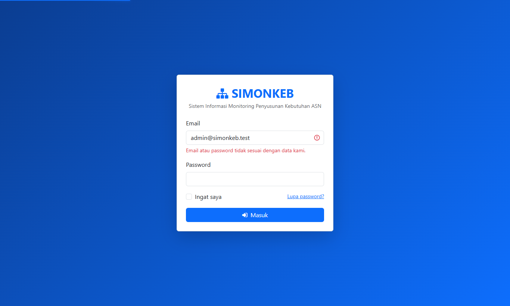

### 03. Halaman terlindung mengalihkan ke login

- **Akun:** `tamu` (belum login)
- **Fungsi:** Semua halaman selain login/panduan publik wajib login.
- **Hasil yang diharapkan:** Dialihkan ke `/login`.

**Langkah (berurutan):**

> **Posisi dalam alur:** Tahap 3 dari 6 pada bagian A. Dilanjutkan dari skenario 02. Login dengan password salah ditolak. Setelah ini: skenario 04. Dashboard admin dan menu lengkap.

1. Langkahnya: tanpa masuk, buka `/dashboard`.

**Hasil pengujian:** ✅ LULUS — Dialihkan ke /login.

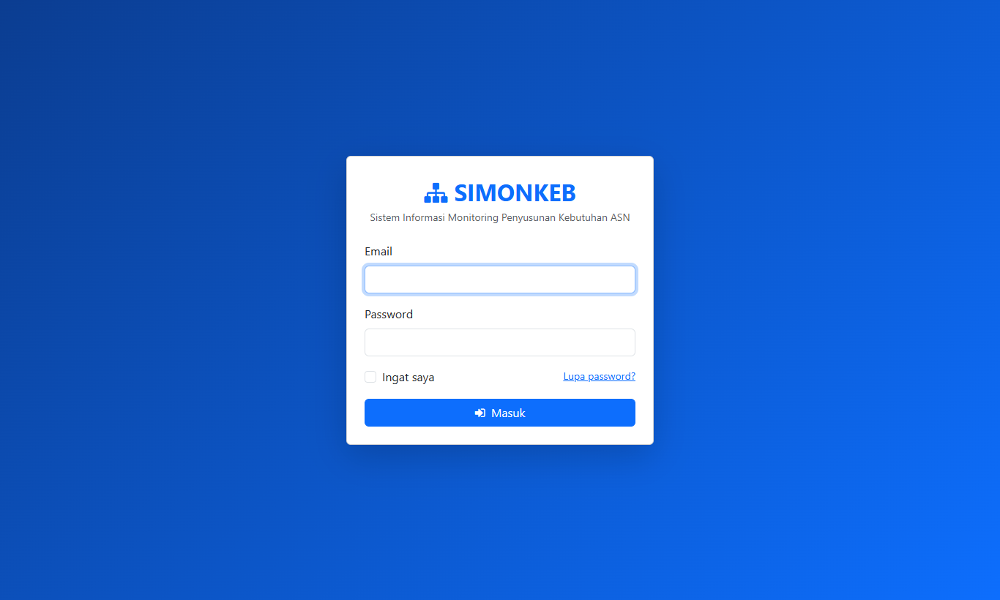

### 04. Dashboard admin dan menu lengkap

- **Akun:** `admin` (admin@simonkeb.test)
- **Fungsi:** Admin melihat seluruh menu (master data, ABK, perencanaan, usulan, monitoring, laporan, pengaturan).
- **Hasil yang diharapkan:** Dashboard tampil; sidebar memuat semua kelompok menu.

**Langkah (berurutan):**

> **Posisi dalam alur:** Tahap 4 dari 6 pada bagian A. Dilanjutkan dari skenario 03. Halaman terlindung mengalihkan ke login. Setelah ini: skenario 05. Pimpinan hanya-baca: menu terbatas.

1. Pertama, masuk sebagai `admin@simonkeb.test`.
2. Terakhir, perhatikan kartu ringkasan dan sidebar.

**Hasil pengujian:** ✅ LULUS — Dashboard tampil, 26 tautan menu.

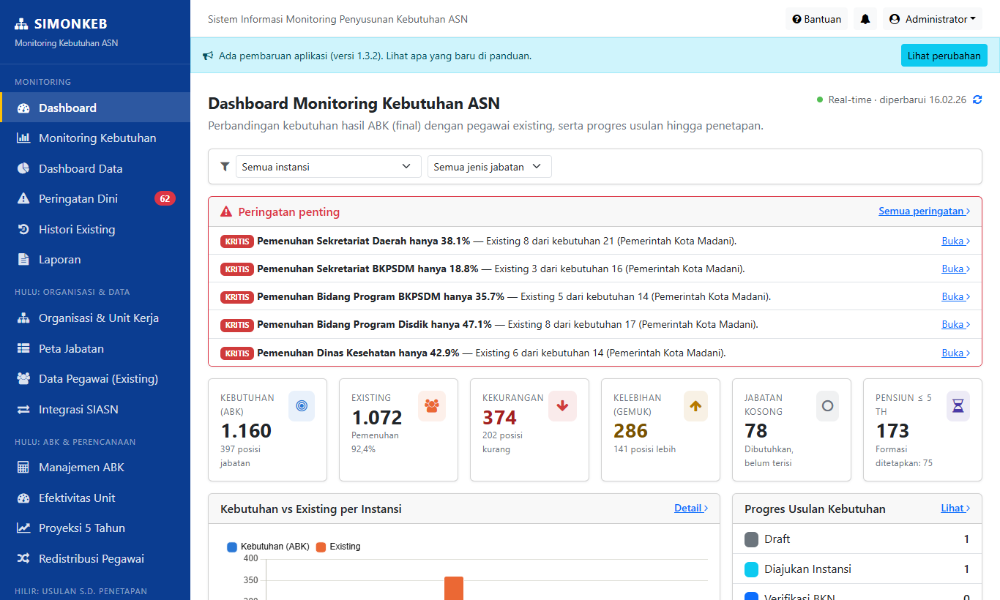

### 05. Pimpinan hanya-baca: menu terbatas

- **Akun:** `pimpinan` (pimpinan@simonkeb.test)
- **Fungsi:** Peran pimpinan tidak boleh mengubah data.
- **Hasil yang diharapkan:** Halaman tambah ditolak (403); daftar pegawai tidak punya tombol Tambah.

**Langkah (berurutan):**

> **Posisi dalam alur:** Tahap 5 dari 6 pada bagian A. Dilanjutkan dari skenario 04. Dashboard admin dan menu lengkap. Setelah ini: skenario 06. Operator dibatasi ke instansinya.

1. Pertama, masuk sebagai `pimpinan@simonkeb.test`.
2. Terakhir, buka `/pegawai/create` (halaman tambah).

**Hasil pengujian:** ✅ LULUS — Tambah ditolak 403; tombol Tambah tidak tampil di daftar.


### 06. Operator dibatasi ke instansinya

- **Akun:** `kab` (kab-sjt@simonkeb.test)
- **Fungsi:** Operator instansi tidak boleh melihat data instansi lain (`Controller::scoped()` / `authorizeInstansi()`).
- **Hasil yang diharapkan:** Ditolak 403.

**Langkah (berurutan):**

> **Posisi dalam alur:** Tahap 6 dari 6 pada bagian A. Dilanjutkan dari skenario 05. Pimpinan hanya-baca: menu terbatas. Setelah ini: skenario 07. Daftar instansi dan pencarian.

1. Pertama, masuk sebagai `kab-sjt@simonkeb.test` (Pemerintah Kabupaten Sejahtera).
2. Terakhir, buka usulan milik Pemerintah Provinsi Nusantara (`/usulan/3`).

**Hasil pengujian:** ✅ LULUS — Akses lintas instansi ditolak (403).


---

## B. Master data organisasi

Instansi → Unit kerja → Jabatan → Pegawai. Semua dites dengan data baru "Uji Dokumentasi" agar data demo tidak tercampur.

**Hubungan dengan tahap sebelumnya:** Setelah akses terbukti aman, data dasar disiapkan secara berurutan: instansi, lalu unit kerja, lalu jabatan, lalu pegawai. Data ini menjadi bahan tahap C dan E.

### 07. Daftar instansi dan pencarian

- **Akun:** `admin` (admin@simonkeb.test)
- **Fungsi:** Mengelola instansi pengguna aplikasi (kabupaten, kota, provinsi, kementerian).
- **Hasil yang diharapkan:** Daftar 4 instansi demo (KL-ADM, KAB-SJT, KOT-MDN, PROV-NSN); pencarian menyaring.

**Langkah (berurutan):**

> **Posisi dalam alur:** Tahap 1 dari 14 pada bagian B. Dilanjutkan dari skenario 06. Operator dibatasi ke instansinya. Setelah ini: skenario 08. Tambah instansi.

1. Pertama, menu **Instansi**.
2. Terakhir, ketik `Sejahtera` pada kotak cari.

**Hasil pengujian:** ✅ LULUS — Daftar dan pencarian berfungsi.

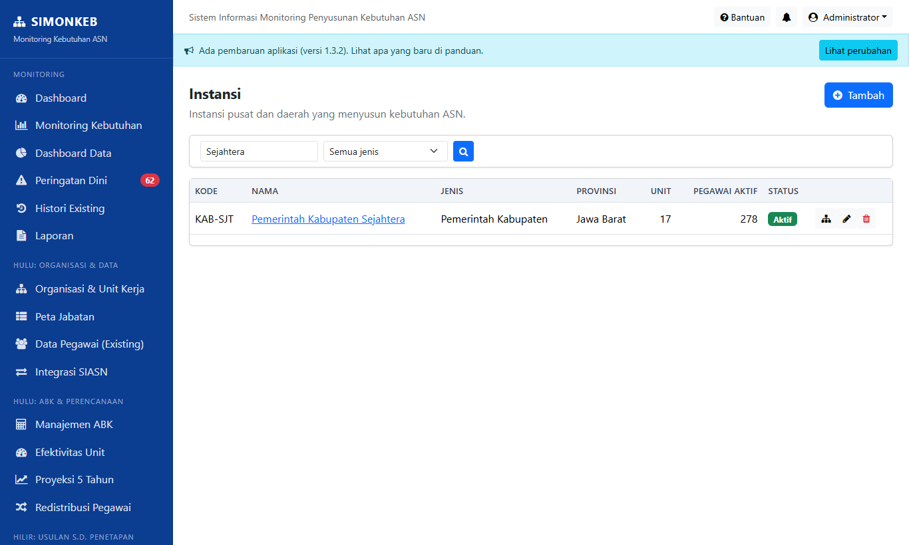

### 08. Tambah instansi

- **Akun:** `admin` (admin@simonkeb.test)
- **Fungsi:** Membuat instansi baru.
- **Hasil yang diharapkan:** Kembali ke daftar, instansi baru tampil, ada notifikasi sukses.

**Langkah (berurutan):**

> **Posisi dalam alur:** Tahap 2 dari 14 pada bagian B. Dilanjutkan dari skenario 07. Daftar instansi dan pencarian. Setelah ini: skenario 09. Validasi: kode instansi tidak boleh kembar.

1. Pertama, di daftar instansi klik **Tambah**.
2. Kemudian, isi Kode `UJI-01`, Nama `Instansi Uji Dokumentasi`, pilih Jenis.
3. Terakhir, klik **Simpan**.

**Hasil pengujian:** ✅ LULUS — Instansi UJI-01 tersimpan.

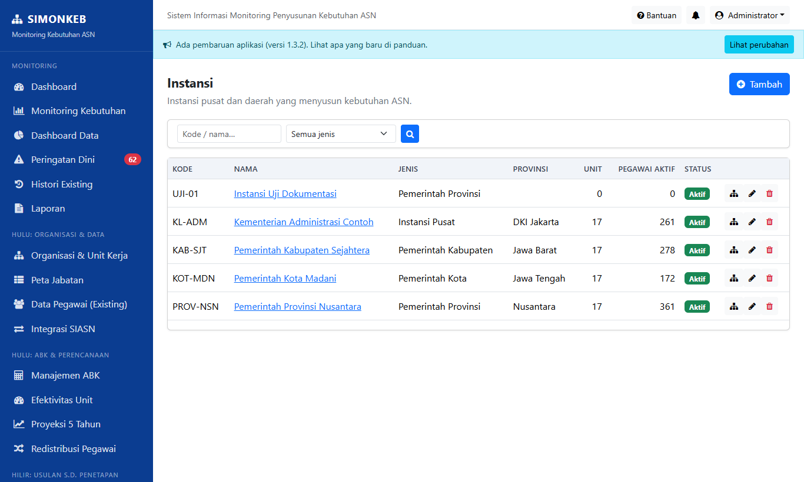

### 09. Validasi: kode instansi tidak boleh kembar

- **Akun:** `admin` (admin@simonkeb.test)
- **Fungsi:** Mencegah duplikasi kode.
- **Hasil yang diharapkan:** Muncul pesan kesalahan pada kolom Kode, data tidak tersimpan.

**Langkah (berurutan):**

> **Posisi dalam alur:** Tahap 3 dari 14 pada bagian B. Dilanjutkan dari skenario 08. Tambah instansi. Setelah ini: skenario 10. Ubah instansi.

1. Pertama, tambah instansi dengan Kode `UJI-01` lagi.
2. Terakhir, simpan.

**Hasil pengujian:** ✅ LULUS — Ditolak dengan pesan galat di kolom Kode.

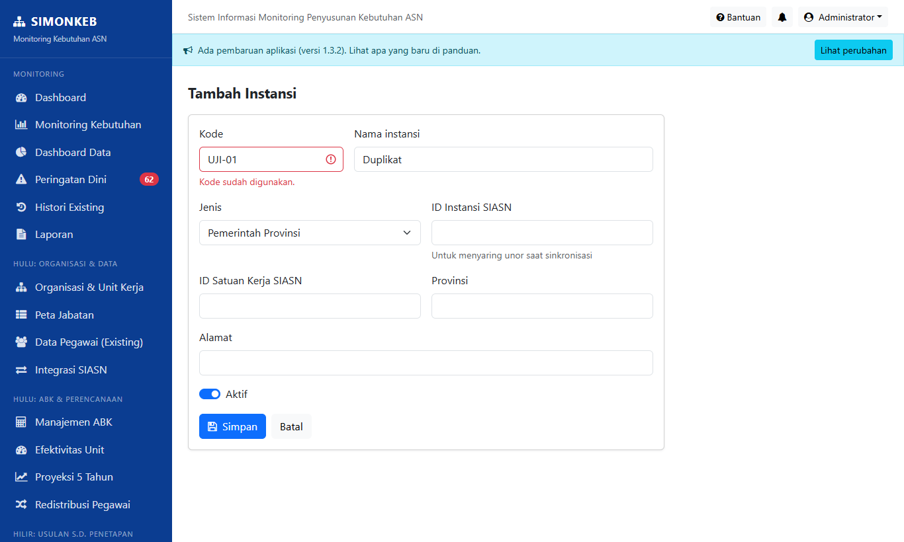

### 10. Ubah instansi

- **Akun:** `admin` (admin@simonkeb.test)
- **Fungsi:** Mengubah data instansi.
- **Hasil yang diharapkan:** Perubahan tersimpan.

**Langkah (berurutan):**

> **Posisi dalam alur:** Tahap 4 dari 14 pada bagian B. Dilanjutkan dari skenario 09. Validasi: kode instansi tidak boleh kembar. Setelah ini: skenario 11. Verifikasi perbaikan: pilihan instansi tetap terpilih pada form Unit, Pegawai, dan ABK.

1. Pertama, pada baris instansi uji klik ikon pensil.
2. Kemudian, isi Provinsi `Provinsi Uji`.
3. Terakhir, simpan.

**Hasil pengujian:** ✅ LULUS — Provinsi diubah.

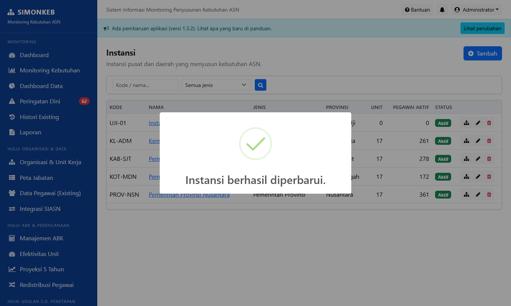

### 11. Verifikasi perbaikan: pilihan instansi tetap terpilih pada form Unit, Pegawai, dan ABK

- **Akun:** `admin` (admin@simonkeb.test)
- **Fungsi:** Form Tambah Unit/Pegawai/ABK dapat dibuka tanpa instansi terpilih (admin dengan filter "Semua instansi"), lalu instansi dipilih dari dropdown. Memilih instansi memuat ulang daftar unit/jabatan.
- **Hasil yang diharapkan:** Pilihan instansi tetap terpilih sampai form disimpan.

**Langkah (berurutan):**

> **Posisi dalam alur:** Tahap 5 dari 14 pada bagian B. Dilanjutkan dari skenario 10. Ubah instansi. Setelah ini: skenario 12. Tambah unit kerja (hierarki).

1. Pertama, buka langsung `/unit-kerja/create`, `/pegawai/create`, dan `/anjab/create` (tanpa parameter `instansi_id`).
2. Kemudian, pada tiap form pilih **Kementerian Administrasi Contoh** di dropdown **Instansi**.
3. Terakhir, tunggu daftar turunan (unit induk / unit kerja) dimuat ulang, lalu perhatikan dropdown Instansi.

**Hasil pengujian:** ✅ LULUS — Pilihan instansi tetap terpilih.

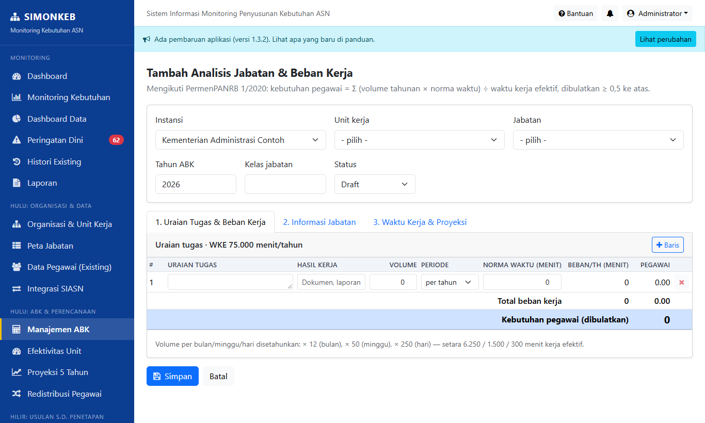

### 12. Tambah unit kerja (hierarki)

- **Akun:** `admin` (admin@simonkeb.test)
- **Fungsi:** Menyusun struktur organisasi bertingkat per instansi.
- **Hasil yang diharapkan:** Unit tampil pada daftar/peta instansi uji.

**Langkah (berurutan):**

> **Posisi dalam alur:** Tahap 6 dari 14 pada bagian B. Dilanjutkan dari skenario 11. Verifikasi perbaikan: pilihan instansi tetap terpilih pada form Unit, Pegawai, dan ABK. Setelah ini: skenario 13. Nonaktifkan / aktifkan unit.

1. Pertama, menu **Organisasi & Unit Kerja** → pilih instansi uji pada filter.
2. Kemudian, klik **Tambah Unit** (instansi sudah terisi otomatis).
3. Selanjutnya, isi Kode `UJI-SEK`, Nama `Sekretariat Uji`, Urutan 1.
4. Terakhir, simpan.

**Hasil pengujian:** ✅ LULUS — Unit tersimpan.

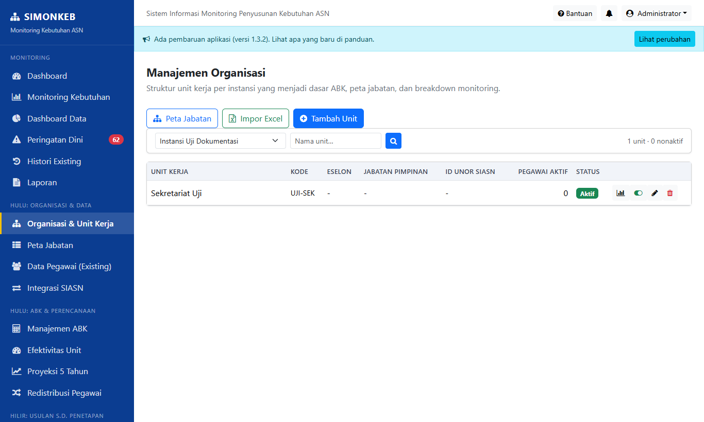

### 13. Nonaktifkan / aktifkan unit

- **Akun:** `admin` (admin@simonkeb.test)
- **Fungsi:** Unit yang tidak aktif tidak dihitung dalam monitoring.
- **Hasil yang diharapkan:** Status berganti.

**Langkah (berurutan):**

> **Posisi dalam alur:** Tahap 7 dari 14 pada bagian B. Dilanjutkan dari skenario 12. Tambah unit kerja (hierarki). Setelah ini: skenario 14. Peta jabatan.

1. Langkahnya: pada baris unit uji klik tombol aktif/nonaktif.

**Hasil pengujian:** ✅ LULUS — Tombol status diklik tanpa galat.

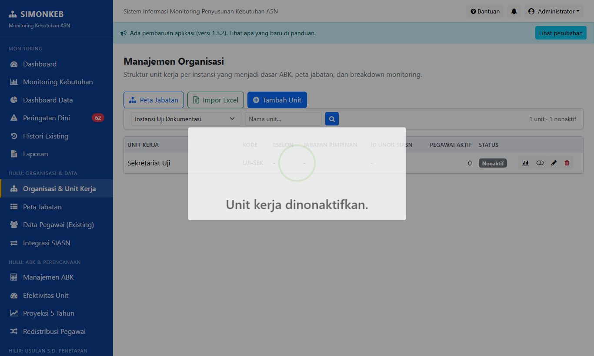

### 14. Peta jabatan

- **Akun:** `admin` (admin@simonkeb.test)
- **Fungsi:** Tampilan hierarki unit beserta jabatan dan jumlah pegawai.
- **Hasil yang diharapkan:** Peta tampil.

**Langkah (berurutan):**

> **Posisi dalam alur:** Tahap 8 dari 14 pada bagian B. Dilanjutkan dari skenario 13. Nonaktifkan / aktifkan unit. Setelah ini: skenario 15. Tambah jabatan referensi.

1. Langkahnya: di halaman Unit Kerja klik **Peta Jabatan**.

**Hasil pengujian:** ✅ LULUS — Peta jabatan tampil.

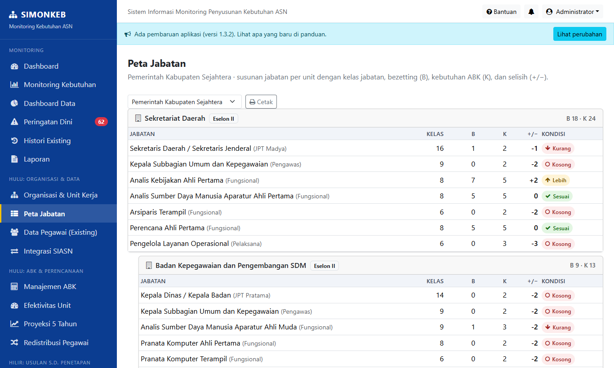

### 15. Tambah jabatan referensi

- **Akun:** `admin` (admin@simonkeb.test)
- **Fungsi:** Katalog jabatan (struktural/JF/JPT) beserta kelas jabatan, BUP, dan estimasi belanja.
- **Hasil yang diharapkan:** Jabatan baru tampil di daftar.

**Langkah (berurutan):**

> **Posisi dalam alur:** Tahap 9 dari 14 pada bagian B. Dilanjutkan dari skenario 14. Peta jabatan. Setelah ini: skenario 16. Tambah pegawai (existing).

1. Pertama, menu **Jabatan** → **Tambah**.
2. Kemudian, isi Kode `UJI-JAB`, Nama `Analis Uji Kebijakan`, pilih Jenis jabatan, Kelas 9, BUP 58, belanja 120000000.
3. Terakhir, simpan.

**Hasil pengujian:** ✅ LULUS — Jabatan tersimpan.

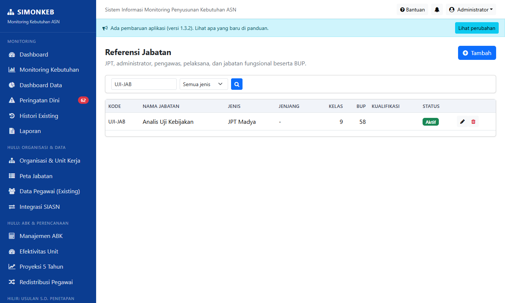

### 16. Tambah pegawai (existing)

- **Akun:** `admin` (admin@simonkeb.test)
- **Fungsi:** Data existing yang dibandingkan dengan kebutuhan hasil ABK. Menyimpan tanggal lahir untuk menghitung TMT pensiun.
- **Hasil yang diharapkan:** Pegawai tersimpan dan tampil di daftar.

**Langkah (berurutan):**

> **Posisi dalam alur:** Tahap 10 dari 14 pada bagian B. Dilanjutkan dari skenario 15. Tambah jabatan referensi. Setelah ini: skenario 17. Validasi NIP pegawai.

1. Pertama, menu **Pegawai** → **Tambah**.
2. Kemudian, instansi terisi otomatis; pilih unit dan jabatan uji.
3. Selanjutnya, isi NIP `199001012015011001`, Nama `Pegawai Uji Dokumentasi`, Tanggal lahir 1990-01-01.
4. Terakhir, simpan.

**Hasil pengujian:** ✅ LULUS — Pegawai tersimpan.

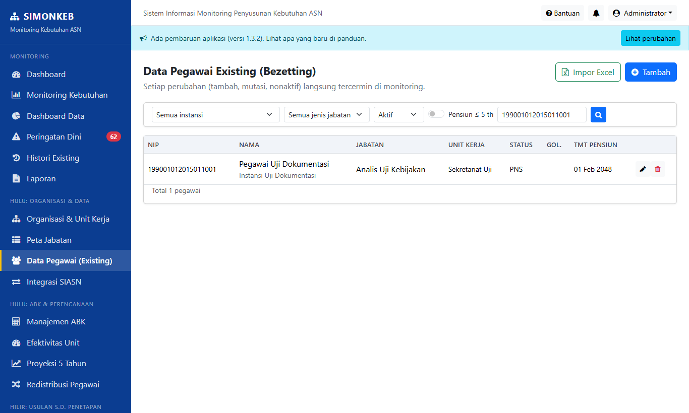

### 17. Validasi NIP pegawai

- **Akun:** `admin` (admin@simonkeb.test)
- **Fungsi:** NIP harus 18 digit dan unik.
- **Hasil yang diharapkan:** Ditolak dengan pesan galat.

**Langkah (berurutan):**

> **Posisi dalam alur:** Tahap 11 dari 14 pada bagian B. Dilanjutkan dari skenario 16. Tambah pegawai (existing). Setelah ini: skenario 18. Ubah pegawai dan riwayat mutasi.

1. Pertama, tambah pegawai dengan NIP `123`.
2. Terakhir, simpan.

**Hasil pengujian:** ✅ LULUS — Ditolak dengan pesan galat.

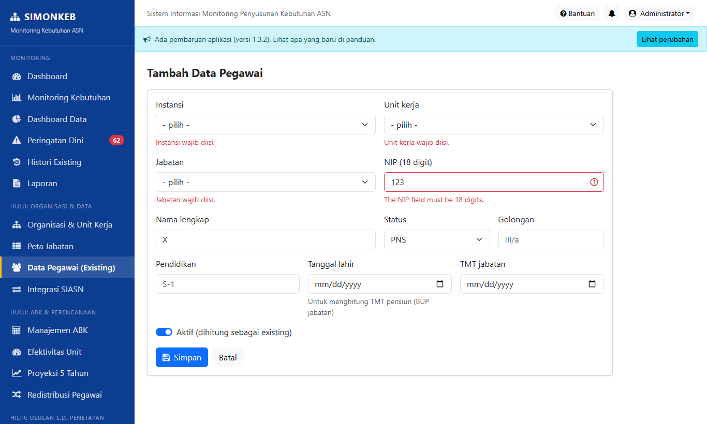

### 18. Ubah pegawai dan riwayat mutasi

- **Akun:** `admin` (admin@simonkeb.test)
- **Fungsi:** Perubahan unit/jabatan/status dicatat otomatis sebagai riwayat; dasar analisis pergerakan data (histori).
- **Hasil yang diharapkan:** Perubahan tersimpan; panel **Riwayat jabatan & mutasi** menampilkan catatan.

**Langkah (berurutan):**

> **Posisi dalam alur:** Tahap 12 dari 14 pada bagian B. Dilanjutkan dari skenario 17. Validasi NIP pegawai. Setelah ini: skenario 19. Halaman impor Excel dan unduh templat.

1. Pertama, buka pegawai uji (ikon pensil).
2. Kemudian, ubah Golongan menjadi `III/b`, isi keterangan `SK Uji 1/2026`.
3. Terakhir, simpan lalu buka lagi.

**Hasil pengujian:** ✅ LULUS — Perubahan tersimpan; panel riwayat tampil.

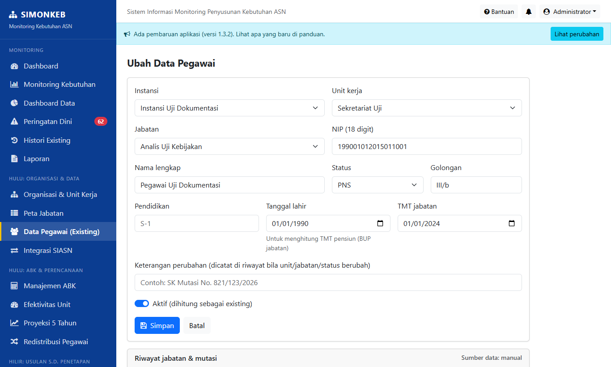

### 19. Halaman impor Excel dan unduh templat

- **Akun:** `admin` (admin@simonkeb.test)
- **Fungsi:** Memasukkan banyak pegawai/unit/ABK sekaligus dari Excel.
- **Hasil yang diharapkan:** Halaman tampil; templat terunduh sebagai .xlsx.

**Langkah (berurutan):**

> **Posisi dalam alur:** Tahap 13 dari 14 pada bagian B. Dilanjutkan dari skenario 18. Ubah pegawai dan riwayat mutasi. Setelah ini: skenario 20. Halaman integrasi SIASN.

1. Pertama, menu **Pegawai** → **Impor Excel**.
2. Terakhir, unduh templat.

**Hasil pengujian:** ✅ LULUS — Halaman tampil. Templat: HTTP 200, application/vnd.openxmlformats-officedocument.spreadsheetml.sheet, 6.602 byte

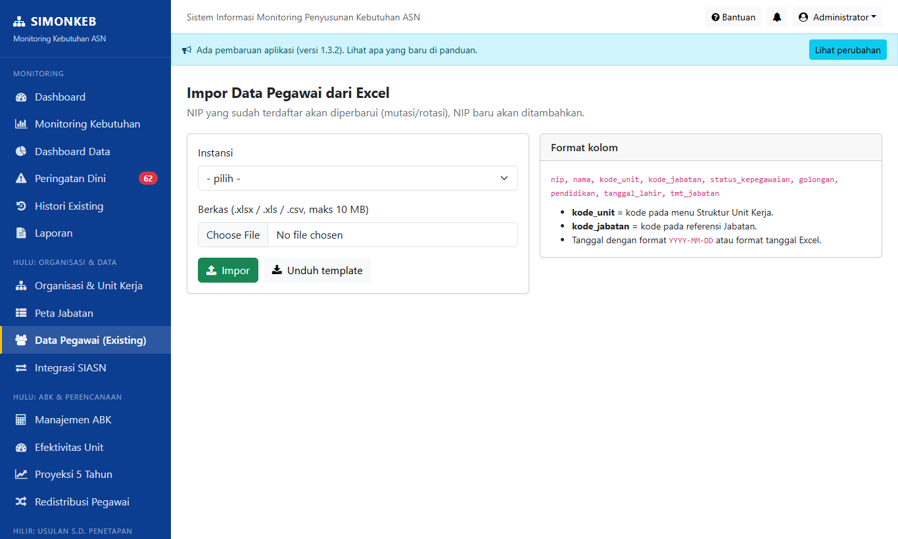

### 20. Halaman integrasi SIASN

- **Akun:** `admin` (admin@simonkeb.test)
- **Fungsi:** Sinkronisasi data pegawai dari SIASN BKN. Dinonaktifkan di lingkungan uji (`SIASN_ENABLED=false`).
- **Hasil yang diharapkan:** Halaman tampil; sinkronisasi memberi pesan bahwa integrasi tidak aktif/kredensial belum diatur (bukan galat 500).

**Langkah (berurutan):**

> **Posisi dalam alur:** Tahap 14 dari 14 pada bagian B. Dilanjutkan dari skenario 19. Halaman impor Excel dan unduh templat. Setelah ini: skenario 21. Daftar ABK dan filter.

1. Pertama, menu **SIASN**.
2. Terakhir, klik **Sinkronkan**.

**Hasil pengujian:** ✅ LULUS — Tombol Sinkronkan nonaktif karena integrasi SIASN dimatikan (SIASN_ENABLED=false), sesuai harapan.

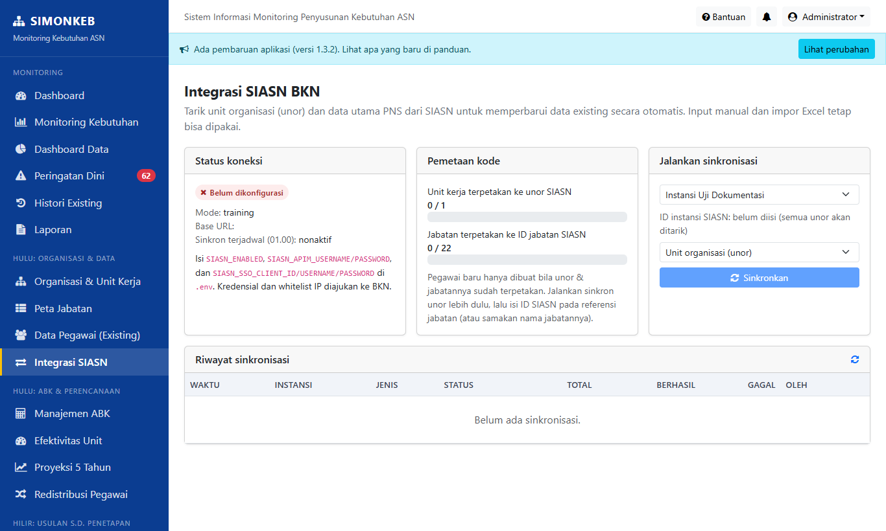


---

## C. Analisis Beban Kerja (ABK)

Rumus PermenPANRB 1/2020: kebutuhan = Σ(volume disetahunkan × norma waktu) ÷ WKE 75.000, pecahan ≥ 0,5 dibulatkan ke atas.

**Hubungan dengan tahap sebelumnya:** Setelah organisasi dan pegawai tersedia, beban kerja tiap jabatan dihitung menjadi kebutuhan pegawai. Hasilnya menjadi dasar tahap D dan E.

### 21. Daftar ABK dan filter

- **Akun:** `admin` (admin@simonkeb.test)
- **Fungsi:** Daftar analisis jabatan & beban kerja per jabatan/unit/tahun.
- **Hasil yang diharapkan:** Daftar ABK demo tampil dan tersaring.

**Langkah (berurutan):**

> **Posisi dalam alur:** Tahap 1 dari 6 pada bagian C. Dilanjutkan dari skenario 20. Halaman integrasi SIASN. Setelah ini: skenario 22. Tambah ABK dan verifikasi rumus.

1. Pertama, menu **ABK**.
2. Terakhir, cari `Analis`.

**Hasil pengujian:** ✅ LULUS — Daftar dan filter berfungsi.

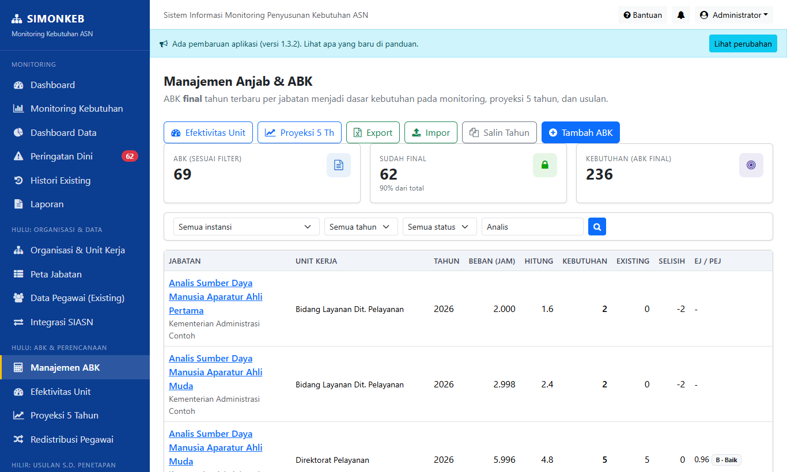

### 22. Tambah ABK dan verifikasi rumus

- **Akun:** `admin` (admin@simonkeb.test)
- **Fungsi:** Menghitung kebutuhan pegawai otomatis dari uraian tugas.
- **Hasil yang diharapkan:** Kebutuhan terhitung 2 (1,53 dibulatkan ke atas); ABK tersimpan.

**Langkah (berurutan):**

> **Posisi dalam alur:** Tahap 2 dari 6 pada bagian C. Dilanjutkan dari skenario 21. Daftar ABK dan filter. Setelah ini: skenario 23. Detail ABK, ubah status dan PDF.

1. Pertama, menu **ABK** → **Tambah ABK**.
2. Kemudian, pilih instansi, unit, jabatan uji; Tahun ABK 2026.
3. Selanjutnya, baris 1: tugas `Menyusun laporan bulanan`, volume 10, periode **per bulan**, norma 500 menit → 10×12×500 = 60.000.
4. Setelah itu, klik **+ Baris**; baris 2: `Rapat koordinasi`, volume 110, **per tahun**, norma 500 → 55.000.
5. Lalu, periksa total 115.000 ÷ 75.000 = 1,53 → dibulatkan **2**.
6. Terakhir, simpan.

**Hasil pengujian:** ✅ LULUS — Total 115.000 mnt ÷ 75.000 = 1,53 → kebutuhan 2 (benar).

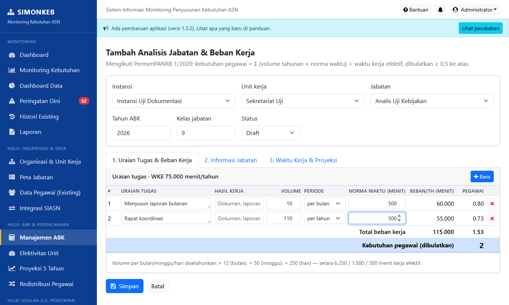

### 23. Detail ABK, ubah status dan PDF

- **Akun:** `admin` (admin@simonkeb.test)
- **Fungsi:** Menampilkan hasil ABK; status draft/final; cetak PDF.
- **Hasil yang diharapkan:** Detail tampil; PDF terunduh (application/pdf).

**Langkah (berurutan):**

> **Posisi dalam alur:** Tahap 3 dari 6 pada bagian C. Dilanjutkan dari skenario 22. Tambah ABK dan verifikasi rumus. Setelah ini: skenario 24. Salin ABK ke tahun lain.

1. Pertama, buka ABK yang baru dibuat dari daftar.
2. Terakhir, klik **PDF**.

**Hasil pengujian:** ✅ LULUS — Detail tampil. PDF: HTTP 200, application/pdf, 879.435 byte

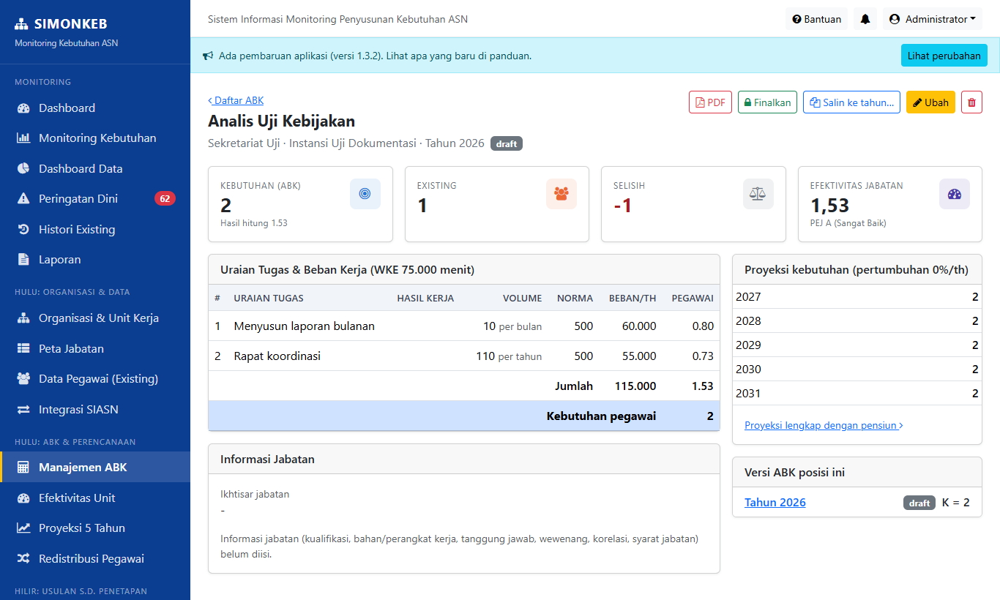

### 24. Salin ABK ke tahun lain

- **Akun:** `admin` (admin@simonkeb.test)
- **Fungsi:** Menyalin ABK tahun berjalan ke tahun berikutnya sebagai bahan revisi.
- **Hasil yang diharapkan:** ABK tahun 2027 terbentuk.

**Langkah (berurutan):**

> **Posisi dalam alur:** Tahap 4 dari 6 pada bagian C. Dilanjutkan dari skenario 23. Detail ABK, ubah status dan PDF. Setelah ini: skenario 25. Ekspor ABK, templat impor, rekap unit.

1. Pertama, di detail ABK klik **Salin ke tahun…**.
2. Terakhir, isi tahun 2027 dan konfirmasi.

**Hasil pengujian:** ✅ LULUS — Salin dijalankan: "ABK disalin ke tahun 2027 sebagai draft. Sesuaikan volume beban kerjanya."

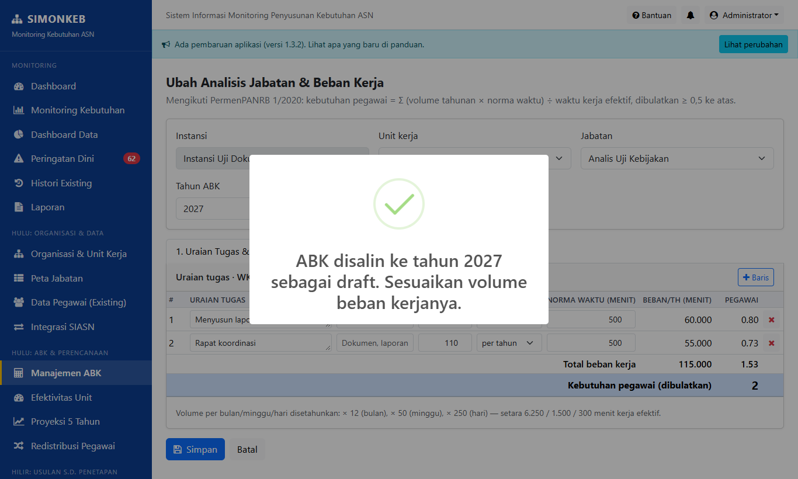

### 25. Ekspor ABK, templat impor, rekap unit

- **Akun:** `admin` (admin@simonkeb.test)
- **Fungsi:** Ekspor Excel, templat untuk impor massal, dan rekap efektivitas per unit.
- **Hasil yang diharapkan:** Berkas Excel terunduh; rekap unit tampil.

**Langkah (berurutan):**

> **Posisi dalam alur:** Tahap 5 dari 6 pada bagian C. Dilanjutkan dari skenario 24. Salin ABK ke tahun lain. Setelah ini: skenario 26. Validasi: ABK tanpa jabatan ditolak.

1. Pertama, di daftar ABK klik **Export**.
2. Kemudian, unduh templat impor.
3. Terakhir, buka **Efektivitas Unit**.

**Hasil pengujian:** ✅ LULUS — Ekspor: HTTP 200, application/vnd.openxmlformats-officedocument.spreadsheetml.sheet, 28.163 byte. Templat: HTTP 200, application/vnd.openxmlformats-officedocument.spreadsheetml.sheet, 6.622 byte. Rekap unit tampil.

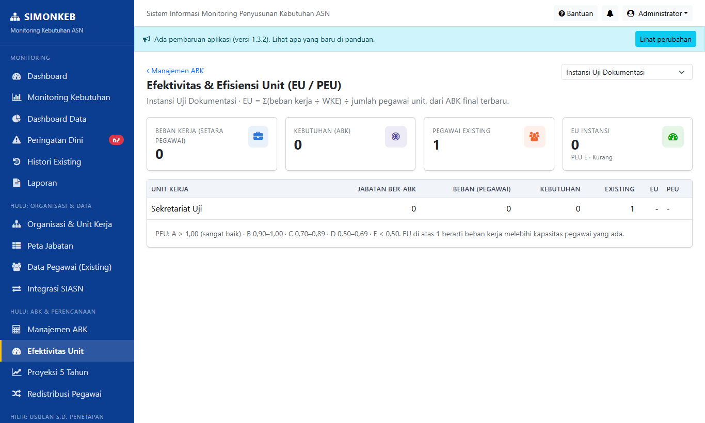

### 26. Validasi: ABK tanpa jabatan ditolak

- **Akun:** `admin` (admin@simonkeb.test)
- **Fungsi:** Formulir ABK memaksa jabatan dan uraian tugas terisi.
- **Hasil yang diharapkan:** Tetap di form, pesan galat tampil.

**Langkah (berurutan):**

> **Posisi dalam alur:** Tahap 6 dari 6 pada bagian C. Dilanjutkan dari skenario 25. Ekspor ABK, templat impor, rekap unit. Setelah ini: skenario 27. Proyeksi 5 tahun dan ekspor.

1. Langkahnya: buka **Tambah ABK**, tanpa memilih apa pun klik **Simpan**.

**Hasil pengujian:** ✅ LULUS — Ditolak dengan pesan galat.

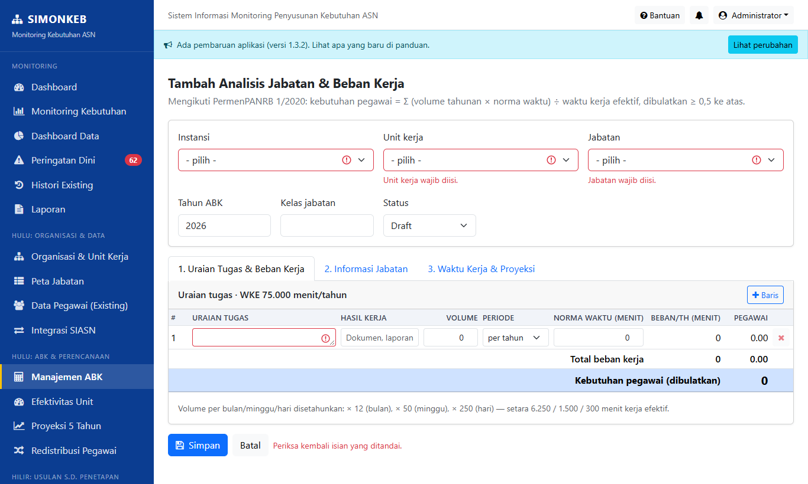


---

## D. Perencanaan

Proyeksi lima tahun, redistribusi pegawai, dan formasi.

**Hubungan dengan tahap sebelumnya:** Berbekal kebutuhan hasil ABK dan data pegawai, tahap ini memproyeksikan lima tahun ke depan serta merencanakan redistribusi dan formasi.

### 27. Proyeksi 5 tahun dan ekspor

- **Akun:** `admin` (admin@simonkeb.test)
- **Fungsi:** Memproyeksikan kebutuhan vs pegawai (pensiun, pertumbuhan beban kerja) lima tahun ke depan.
- **Hasil yang diharapkan:** Tabel/grafik proyeksi tampil; ekspor sukses.

**Langkah (berurutan):**

> **Posisi dalam alur:** Tahap 1 dari 3 pada bagian D. Dilanjutkan dari skenario 26. Validasi: ABK tanpa jabatan ditolak. Setelah ini: skenario 28. Saran redistribusi pegawai.

1. Pertama, menu **Proyeksi 5 Th** → pilih instansi.
2. Terakhir, klik **Export Excel**.

**Hasil pengujian:** ✅ LULUS — Proyeksi tampil. Ekspor: HTTP 200, application/vnd.openxmlformats-officedocument.spreadsheetml.sheet, 13.106 byte

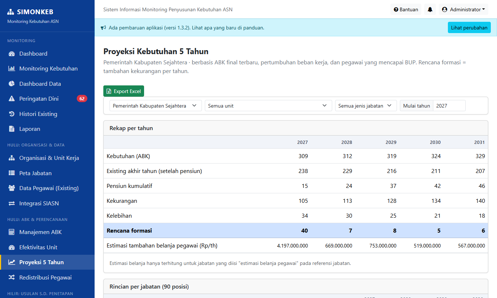

### 28. Saran redistribusi pegawai

- **Akun:** `admin` (admin@simonkeb.test)
- **Fungsi:** Menyarankan pemindahan dari jabatan gemuk ke jabatan kurang pada instansi yang sama.
- **Hasil yang diharapkan:** Halaman tampil dengan saran (atau pesan kosong).

**Langkah (berurutan):**

> **Posisi dalam alur:** Tahap 2 dari 3 pada bagian D. Dilanjutkan dari skenario 27. Proyeksi 5 tahun dan ekspor. Setelah ini: skenario 29. Formasi / pengisian formasi.

1. Langkahnya: menu **Redistribusi** → pilih instansi.

**Hasil pengujian:** ✅ LULUS — Halaman redistribusi tampil.

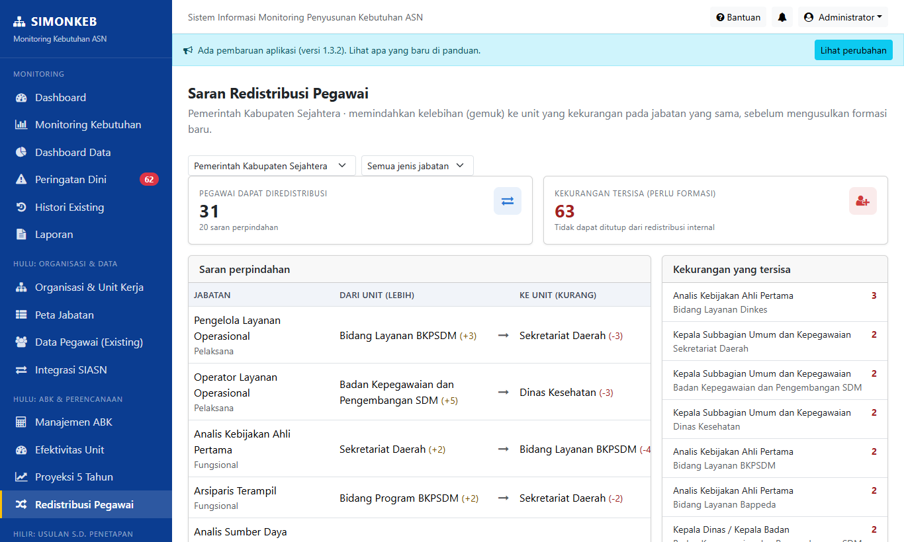

### 29. Formasi / pengisian formasi

- **Akun:** `admin` (admin@simonkeb.test)
- **Fungsi:** Mencatat formasi yang sudah terisi per jabatan sebagai pengurang kebutuhan.
- **Hasil yang diharapkan:** Tabel formasi tampil.

**Langkah (berurutan):**

> **Posisi dalam alur:** Tahap 3 dari 3 pada bagian D. Dilanjutkan dari skenario 28. Saran redistribusi pegawai. Setelah ini: skenario 30. Daftar usulan operator.

1. Langkahnya: menu **Formasi** → pilih instansi dan tahun.

**Hasil pengujian:** ✅ LULUS — Halaman formasi tampil.

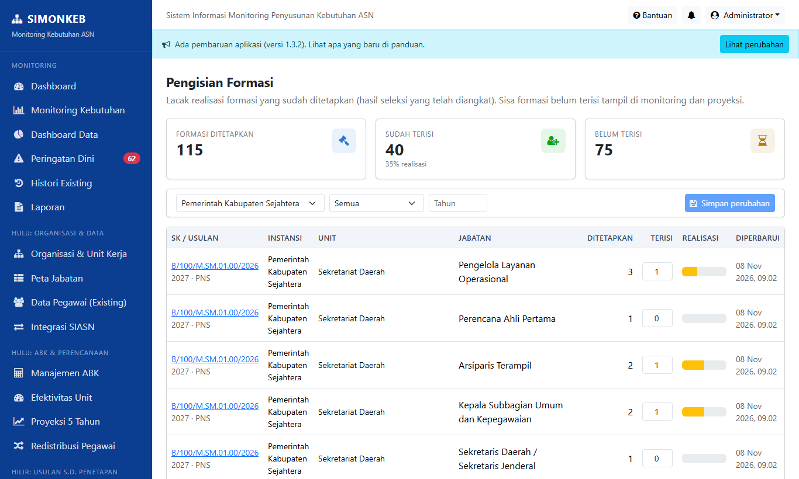


---

## E. Usulan kebutuhan & alur persetujuan

draft → diajukan → verifikasi BKN → pertimbangan teknis → validasi Kemenpan → ditetapkan, dengan cabang dikembalikan/ditolak.

**Hubungan dengan tahap sebelumnya:** Kebutuhan hasil ABK dan perencanaan dirangkum menjadi usulan, lalu diproses lintas peran sampai ditetapkan atau ditolak.

### 30. Daftar usulan operator

- **Akun:** `kab` (kab-sjt@simonkeb.test)
- **Fungsi:** Operator hanya melihat usulan instansinya.
- **Hasil yang diharapkan:** Hanya usulan Kabupaten Sejahtera tampil.

**Langkah (berurutan):**

> **Posisi dalam alur:** Tahap 1 dari 11 pada bagian E. Dilanjutkan dari skenario 29. Formasi / pengisian formasi. Setelah ini: skenario 31. Buat usulan baru (draft) lalu hapus.

1. Pertama, masuk sebagai operator Kabupaten.
2. Terakhir, menu **Usulan**.

**Hasil pengujian:** ✅ LULUS — 1 baris usulan (hanya instansi sendiri).

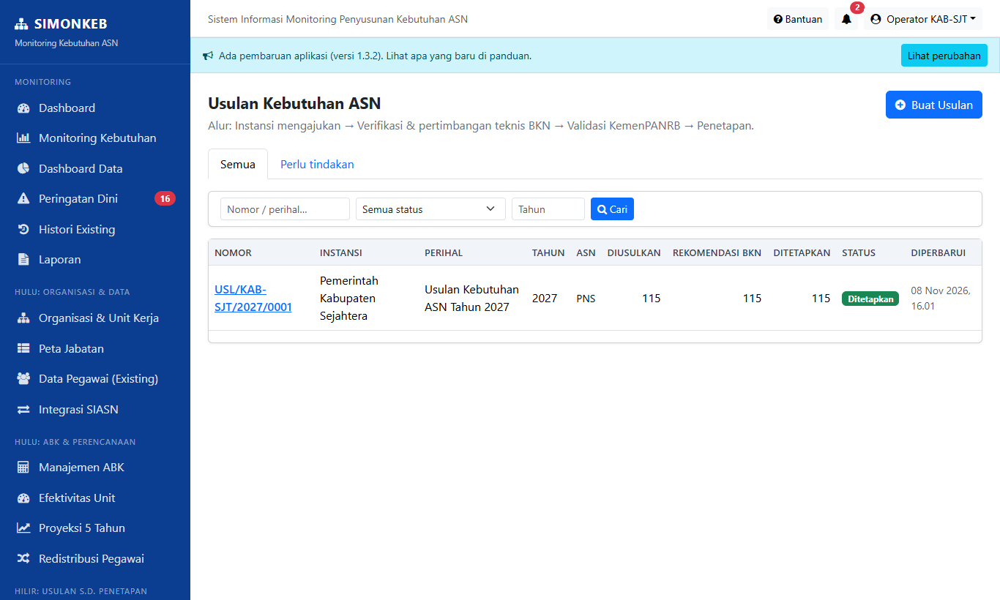

### 31. Buat usulan baru (draft) lalu hapus

- **Akun:** `kab` (kab-sjt@simonkeb.test)
- **Fungsi:** Operator membuat usulan; hanya draft yang dapat dihapus.
- **Hasil yang diharapkan:** Usulan draft terbentuk lalu terhapus.

**Langkah (berurutan):**

> **Posisi dalam alur:** Tahap 2 dari 11 pada bagian E. Dilanjutkan dari skenario 30. Daftar usulan operator. Setelah ini: skenario 32. Isi rincian jabatan (tarik dari ABK) dan ajukan.

1. Pertama, menu **Usulan** → **Buat Usulan**.
2. Kemudian, isi Tahun 2028, Perihal `Usulan Uji Dokumentasi`.
3. Selanjutnya, simpan → halaman detail berstatus Draft.
4. Terakhir, klik ikon tempat sampah dan konfirmasi.

**Hasil pengujian:** ✅ LULUS — Draft terbentuk di /usulan/5

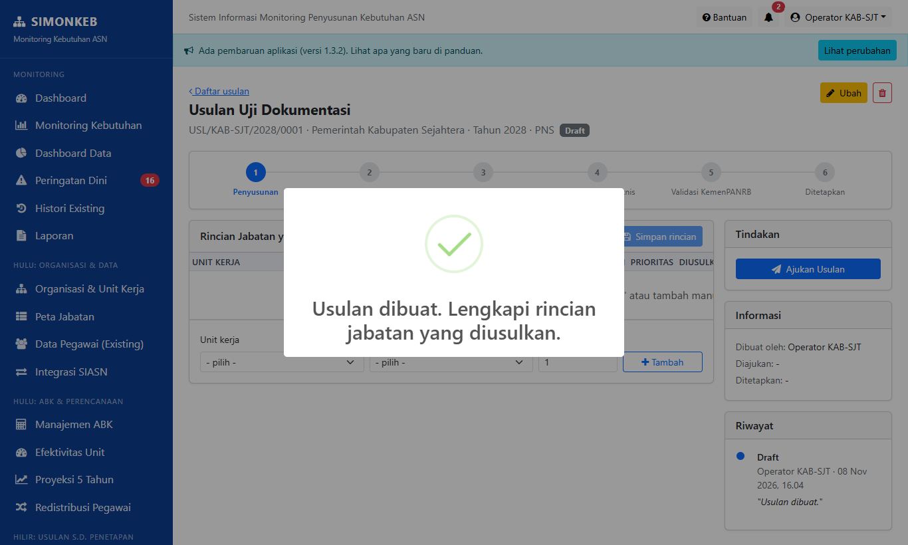

### 32. Isi rincian jabatan (tarik dari ABK) dan ajukan

- **Akun:** `kl` (kl-adm@simonkeb.test)
- **Fungsi:** Rincian jabatan diusulkan dapat ditarik otomatis dari hasil ABK, diubah, lalu diajukan.
- **Hasil yang diharapkan:** Rincian terisi dari ABK; status berubah menjadi *diajukan*.

**Langkah (berurutan):**

> **Posisi dalam alur:** Tahap 3 dari 11 pada bagian E. Dilanjutkan dari skenario 31. Buat usulan baru (draft) lalu hapus. Setelah ini: skenario 33. Verifikator BKN: mulai verifikasi.

1. Pertama, masuk sebagai operator Kementerian, buka usulan draft (`/usulan/4`).
2. Kemudian, klik **Tarik dari ABK** dan konfirmasi dialog.
3. Selanjutnya, klik **Simpan rincian** bila aktif.
4. Terakhir, klik **Ajukan Usulan** pada panel Tindakan dan konfirmasi.

**Hasil pengujian:** ✅ LULUS — 61 baris rincian; status sekarang: Diajukan Instansi.

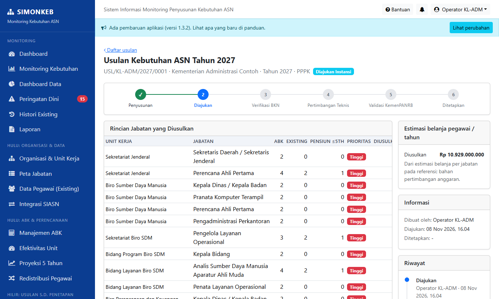

### 33. Verifikator BKN: mulai verifikasi

- **Akun:** `bkn` (bkn@simonkeb.test)
- **Fungsi:** BKN memeriksa kelengkapan dan mulai memverifikasi usulan yang diajukan.
- **Hasil yang diharapkan:** Status menjadi *verifikasi BKN*.

**Langkah (berurutan):**

> **Posisi dalam alur:** Tahap 4 dari 11 pada bagian E. Dilanjutkan dari skenario 32. Isi rincian jabatan (tarik dari ABK) dan ajukan. Setelah ini: skenario 34. Verifikator BKN: beri rekomendasi (pertimbangan teknis).

1. Pertama, masuk sebagai Verifikator BKN, buka `/usulan/4`.
2. Terakhir, klik **Mulai Verifikasi** dan konfirmasi (dialog "Ya, lanjutkan").

**Hasil pengujian:** ✅ LULUS — Status: Verifikasi BKN

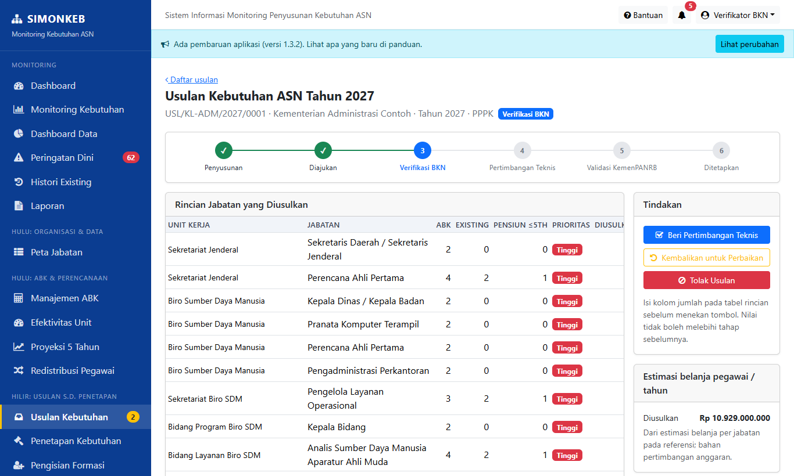

### 34. Verifikator BKN: beri rekomendasi (pertimbangan teknis)

- **Akun:** `bkn` (bkn@simonkeb.test)
- **Fungsi:** BKN mengisi jumlah rekomendasi per jabatan (tidak boleh melebihi jumlah diusulkan).
- **Hasil yang diharapkan:** Status menjadi *pertimbangan teknis*.

**Langkah (berurutan):**

> **Posisi dalam alur:** Tahap 5 dari 11 pada bagian E. Dilanjutkan dari skenario 33. Verifikator BKN: mulai verifikasi. Setelah ini: skenario 35. Validator Kemenpan: mulai validasi.

1. Pertama, pada usulan yang sama klik **Beri Pertimbangan Teknis**.
2. Terakhir, pastikan kolom *Rekomendasi BKN* terisi, konfirmasi.

**Hasil pengujian:** ✅ LULUS — Status: Pertimbangan Teknis BKN

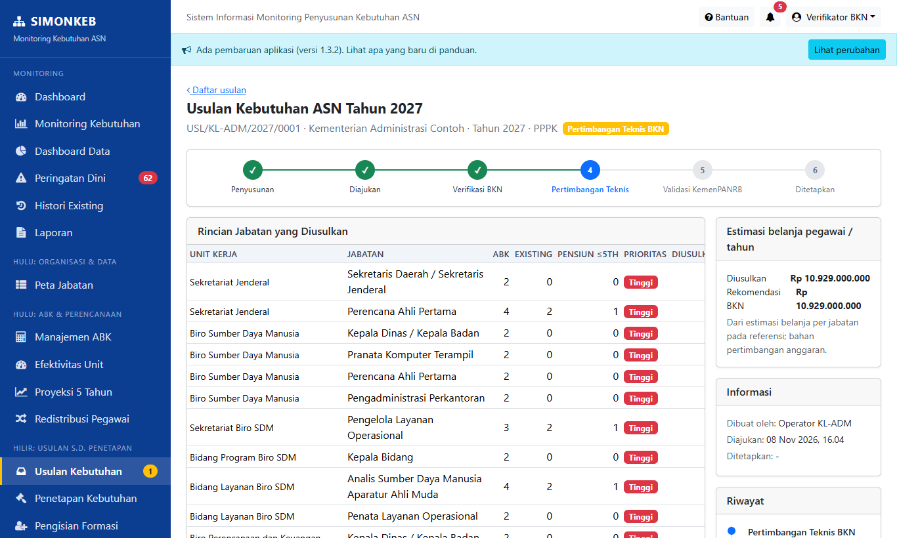

### 35. Validator Kemenpan: mulai validasi

- **Akun:** `kemenpan` (kemenpan@simonkeb.test)
- **Fungsi:** Kemenpan memvalidasi hasil pertimbangan teknis.
- **Hasil yang diharapkan:** Status menjadi *validasi Kemenpan*.

**Langkah (berurutan):**

> **Posisi dalam alur:** Tahap 6 dari 11 pada bagian E. Dilanjutkan dari skenario 34. Verifikator BKN: beri rekomendasi (pertimbangan teknis). Setelah ini: skenario 36. Penetapan kebutuhan dengan nomor SK.

1. Pertama, masuk sebagai Validator Kemenpan, buka `/usulan/4`.
2. Terakhir, klik **Mulai Validasi** dan konfirmasi.

**Hasil pengujian:** ✅ LULUS — Status: Validasi KemenPANRB

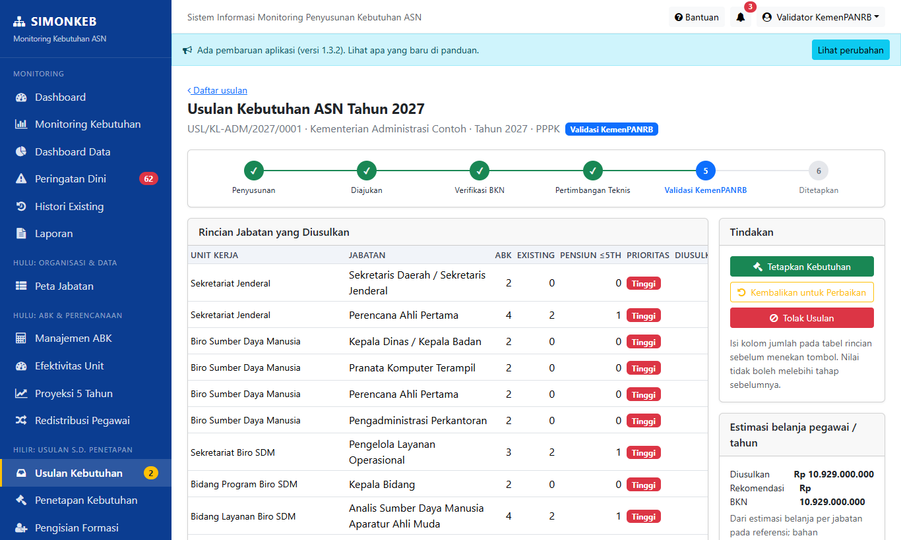

### 36. Penetapan kebutuhan dengan nomor SK

- **Akun:** `kemenpan` (kemenpan@simonkeb.test)
- **Fungsi:** Penetapan akhir: mengisi jumlah ditetapkan serta data SK, lalu membuat lampiran penetapan.
- **Hasil yang diharapkan:** Status *ditetapkan*; lampiran penetapan tersedia dan PDF dapat diunduh.

**Langkah (berurutan):**

> **Posisi dalam alur:** Tahap 7 dari 11 pada bagian E. Dilanjutkan dari skenario 35. Validator Kemenpan: mulai validasi. Setelah ini: skenario 37. Cabang: usulan dikembalikan untuk perbaikan.

1. Pertama, pada usulan yang sama isi **Nomor SK** `SK-UJI/2026/001` dan **Tanggal SK**.
2. Kemudian, klik **Tetapkan Kebutuhan** dan konfirmasi.
3. Terakhir, buka **Lampiran penetapan**.

**Hasil pengujian:** ✅ LULUS — Ditetapkan. Lampiran: HTTP 200, application/pdf, 886.948 byte

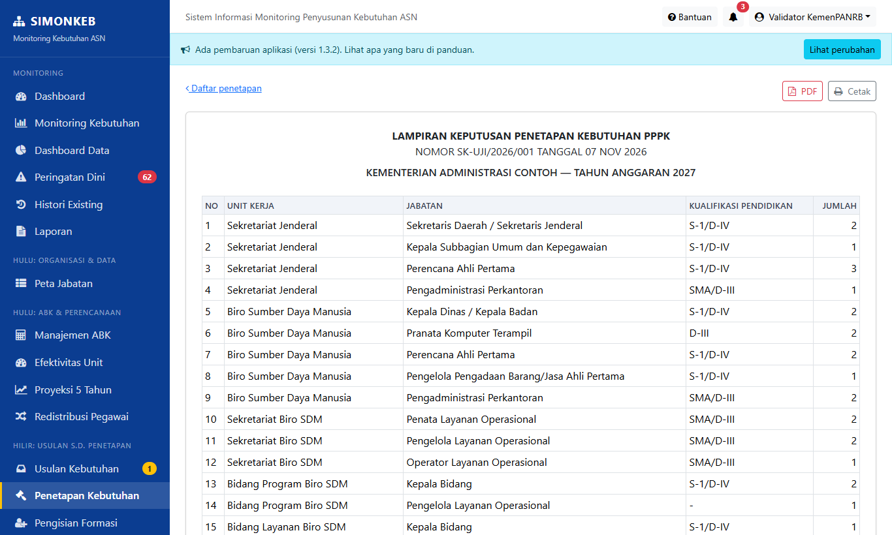

### 37. Cabang: usulan dikembalikan untuk perbaikan

- **Akun:** `bkn` (bkn@simonkeb.test)
- **Fungsi:** BKN mengembalikan usulan dengan catatan; operator memperbaiki lalu mengajukan ulang.
- **Hasil yang diharapkan:** Status *dikembalikan* dengan catatan terlihat.

**Langkah (berurutan):**

> **Posisi dalam alur:** Tahap 8 dari 11 pada bagian E. Dilanjutkan dari skenario 36. Penetapan kebutuhan dengan nomor SK. Setelah ini: skenario 38. Operator melihat catatan pengembalian dan mengajukan ulang.

1. Pertama, masuk sebagai Verifikator BKN, buka usulan berstatus *diajukan* (`/usulan/3`).
2. Kemudian, klik **Mulai Verifikasi**, lalu **Kembalikan untuk Perbaikan**.
3. Terakhir, isi catatan `Lengkapi lampiran ABK` dan konfirmasi.

**Hasil pengujian:** ✅ LULUS — Status: Dikembalikan (Perbaikan), catatan tampil.

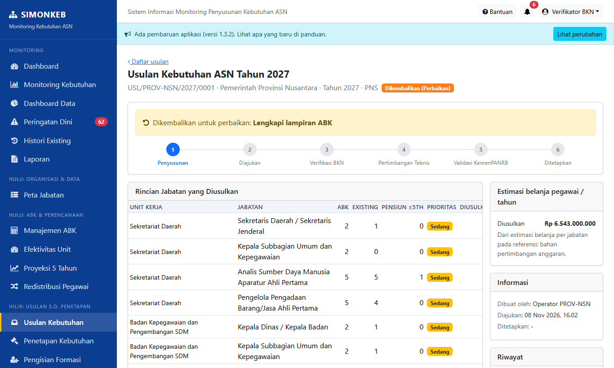

### 38. Operator melihat catatan pengembalian dan mengajukan ulang

- **Akun:** `prov` (prov-nsn@simonkeb.test)
- **Fungsi:** Siklus perbaikan oleh operator.
- **Hasil yang diharapkan:** Banner pengembalian tampil; status kembali *diajukan*.

**Langkah (berurutan):**

> **Posisi dalam alur:** Tahap 9 dari 11 pada bagian E. Dilanjutkan dari skenario 37. Cabang: usulan dikembalikan untuk perbaikan. Setelah ini: skenario 39. Cabang: usulan ditolak.

1. Pertama, masuk sebagai operator Provinsi, buka `/usulan/3`.
2. Terakhir, baca banner kuning, klik **Ajukan Usulan** lagi.

**Hasil pengujian:** ✅ LULUS — Diajukan ulang; status: Diajukan Instansi

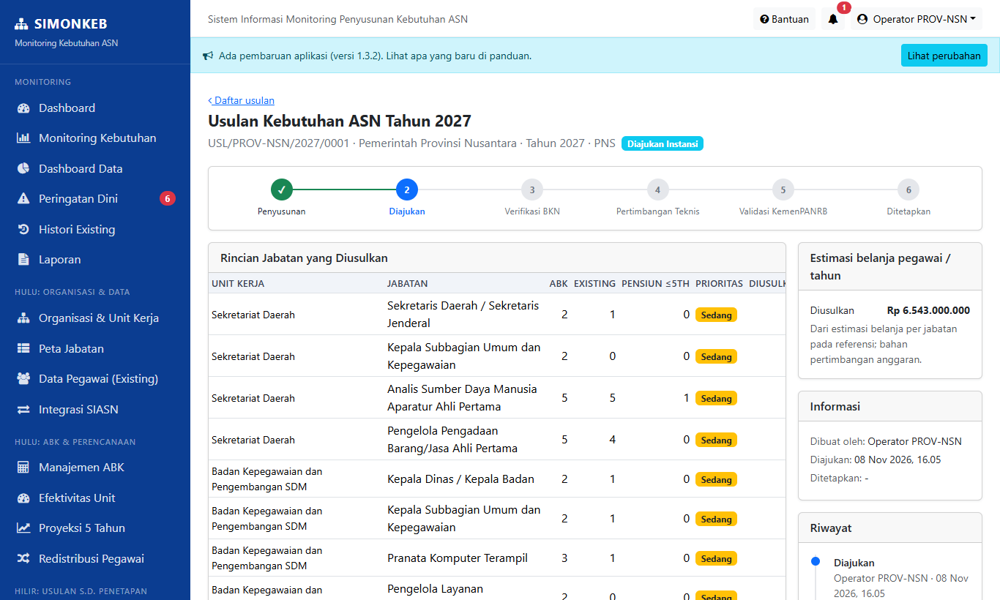

### 39. Cabang: usulan ditolak

- **Akun:** `kemenpan` (kemenpan@simonkeb.test)
- **Fungsi:** Kemenpan dapat menolak usulan pada tahap validasi dengan alasan wajib.
- **Hasil yang diharapkan:** Status *ditolak* dengan alasan terlihat.

**Langkah (berurutan):**

> **Posisi dalam alur:** Tahap 10 dari 11 pada bagian E. Dilanjutkan dari skenario 38. Operator melihat catatan pengembalian dan mengajukan ulang. Setelah ini: skenario 40. Daftar penetapan.

1. Pertama, masuk sebagai Validator Kemenpan, buka usulan berstatus pertimbangan teknis (`/usulan/2`).
2. Kemudian, klik **Mulai Validasi**, lalu **Tolak Usulan**.
3. Terakhir, isi alasan `Tidak sesuai peta jabatan` dan konfirmasi.

**Hasil pengujian:** ✅ LULUS — Status: Ditolak, alasan tampil.

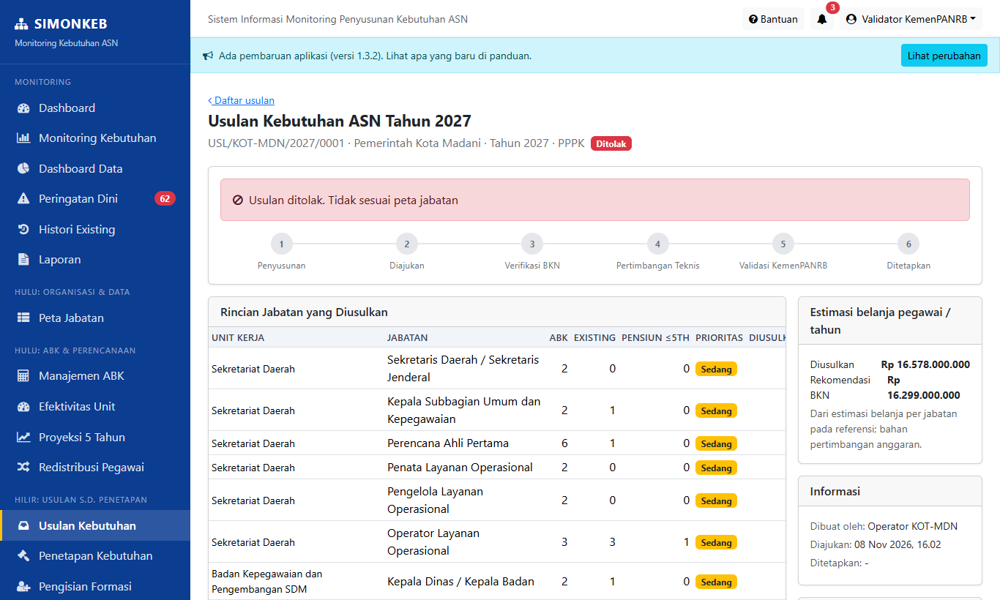

### 40. Daftar penetapan

- **Akun:** `admin` (admin@simonkeb.test)
- **Fungsi:** Arsip SK penetapan kebutuhan.
- **Hasil yang diharapkan:** SK hasil alur di atas tampil.

**Langkah (berurutan):**

> **Posisi dalam alur:** Tahap 11 dari 11 pada bagian E. Dilanjutkan dari skenario 39. Cabang: usulan ditolak. Setelah ini: skenario 41. Monitoring kebutuhan vs existing.

1. Pertama, menu **Penetapan**.
2. Terakhir, cari nomor `SK-UJI`.

**Hasil pengujian:** ✅ LULUS — 2 penetapan terdaftar.

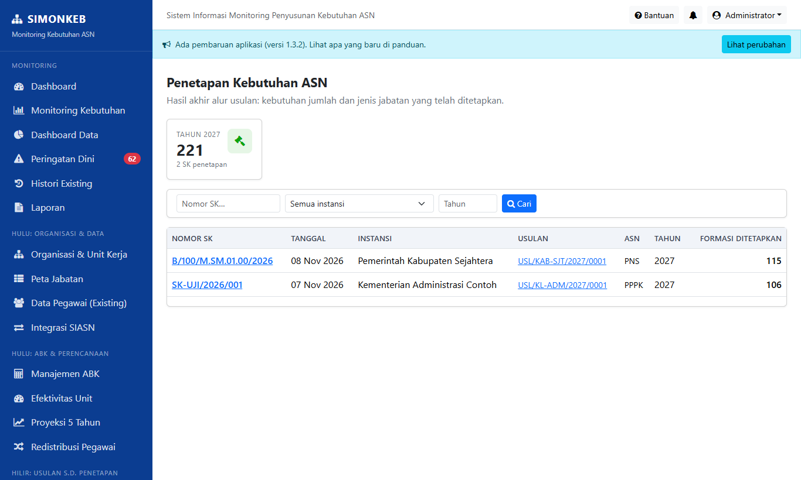


---

## F. Monitoring, analitik, histori, peringatan, laporan

Pemantauan kebutuhan vs existing dan keluaran pelaporan.

**Hubungan dengan tahap sebelumnya:** Setelah usulan berjalan, tahap ini memantau capaiannya dan menghasilkan laporan untuk pimpinan.

### 41. Monitoring kebutuhan vs existing

- **Akun:** `admin` (admin@simonkeb.test)
- **Fungsi:** Selisih kebutuhan dan pegawai per instansi → unit → jabatan, dengan status kurang/lebih/kosong.
- **Hasil yang diharapkan:** Tabel tampil; drill-down berfungsi; ekspor sukses.

**Langkah (berurutan):**

> **Posisi dalam alur:** Tahap 1 dari 5 pada bagian F. Dilanjutkan dari skenario 40. Daftar penetapan. Setelah ini: skenario 42. Analitik.

1. Pertama, menu **Monitoring**.
2. Kemudian, klik salah satu instansi untuk drill-down.
3. Terakhir, klik **Export Excel**.

**Hasil pengujian:** ✅ LULUS — Drill-down OK. Ekspor: HTTP 200, application/vnd.openxmlformats-officedocument.spreadsheetml.sheet, 23.285 byte

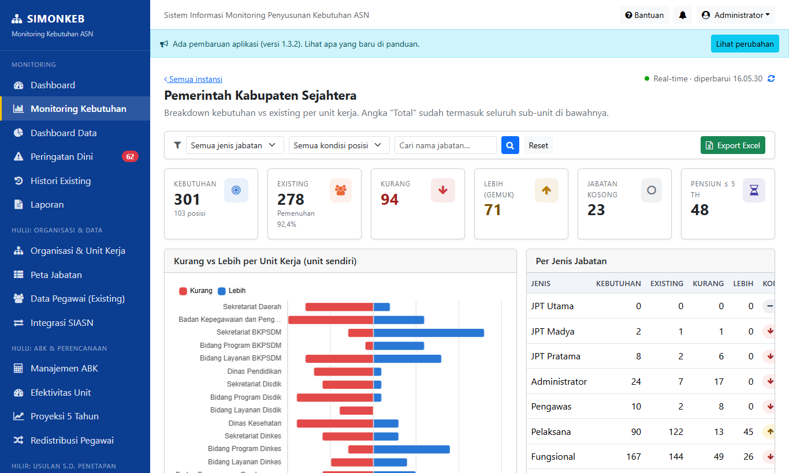

### 42. Analitik

- **Akun:** `admin` (admin@simonkeb.test)
- **Fungsi:** Grafik perbandingan dan sebaran.
- **Hasil yang diharapkan:** Grafik tampil tanpa galat.

**Langkah (berurutan):**

> **Posisi dalam alur:** Tahap 2 dari 5 pada bagian F. Dilanjutkan dari skenario 41. Monitoring kebutuhan vs existing. Setelah ini: skenario 43. Histori existing dan unit tanpa pergerakan.

1. Langkahnya: menu **Analitik**.

**Hasil pengujian:** ✅ LULUS — Halaman analitik tampil.

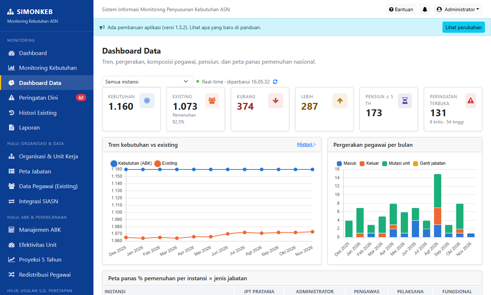

### 43. Histori existing dan unit tanpa pergerakan

- **Akun:** `admin` (admin@simonkeb.test)
- **Fungsi:** Tren existing 12 bulan dan deteksi unit yang datanya tidak bergerak (potensi tidak diperbarui).
- **Hasil yang diharapkan:** Tren tampil; ekspor sukses.

**Langkah (berurutan):**

> **Posisi dalam alur:** Tahap 3 dari 5 pada bagian F. Dilanjutkan dari skenario 42. Analitik. Setelah ini: skenario 44. Peringatan dini: deteksi dan tindak lanjut.

1. Pertama, menu **Histori**.
2. Kemudian, pilih rentang **6 bln**, filter **Hanya yang diam**.
3. Terakhir, klik **Export analisis**.

**Hasil pengujian:** ✅ LULUS — Histori tampil. Ekspor: HTTP 200, application/vnd.openxmlformats-officedocument.spreadsheetml.sheet, 6.920 byte

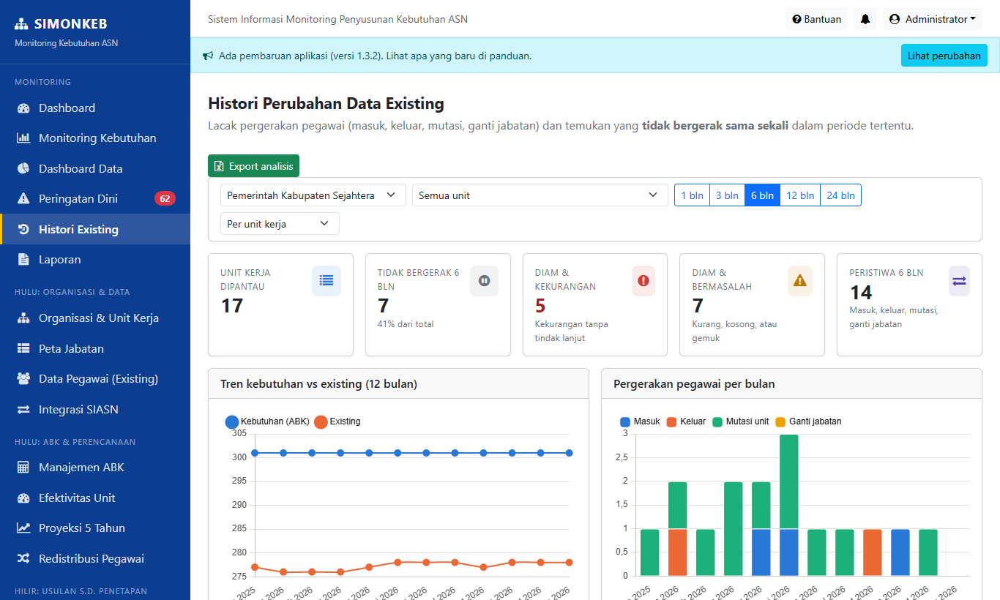

### 44. Peringatan dini: deteksi dan tindak lanjut

- **Akun:** `admin` (admin@simonkeb.test)
- **Fungsi:** Mendeteksi anomali (jabatan kosong, pensiun mendekat, data diam, dll.) dan mencatat tindak lanjut.
- **Hasil yang diharapkan:** Deteksi berjalan; tindak lanjut tersimpan.

**Langkah (berurutan):**

> **Posisi dalam alur:** Tahap 4 dari 5 pada bagian F. Dilanjutkan dari skenario 43. Histori existing dan unit tanpa pergerakan. Setelah ini: skenario 45. Laporan: seluruh jenis (Excel + PDF).

1. Pertama, menu **Peringatan**.
2. Kemudian, klik **Deteksi sekarang**.
3. Terakhir, pada satu peringatan klik **Tindak lanjut**, isi catatan, konfirmasi.

**Hasil pengujian:** ✅ LULUS — Deteksi dijalankan dan tindak lanjut tersimpan.

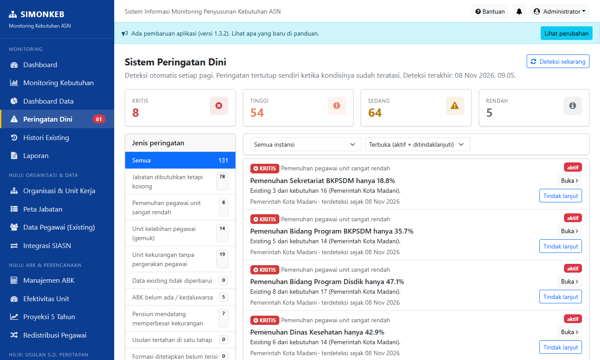

### 45. Laporan: seluruh jenis (Excel + PDF)

- **Akun:** `admin` (admin@simonkeb.test)
- **Fungsi:** Sembilan jenis laporan, masing-masing dapat diunduh Excel dan PDF.
- **Hasil yang diharapkan:** Semua unduhan HTTP 200 dengan tipe berkas benar.

**Langkah (berurutan):**

> **Posisi dalam alur:** Tahap 5 dari 5 pada bagian F. Dilanjutkan dari skenario 44. Peringatan dini: deteksi dan tindak lanjut. Setelah ini: skenario 46. Tambah pengguna.

1. Pertama, menu **Laporan**, pilih jenis di panel kiri.
2. Terakhir, klik **Excel** dan **PDF** untuk tiap jenis.

**Hasil pengujian:** ✅ LULUS — 9 jenis × 2 format berhasil. rekap_instansi: xlsx 6.948 byte, pdf 880.508 byte | rekap_unit: xlsx 6.540 byte, pdf 879.078 byte | rekap_jabatan: xlsx 7.745 byte, pdf 883.767 byte | posisi_bermasalah: xlsx 16.491 byte, pdf 956.268 byte | usulan_penetapan: xlsx 6.873 byte, pdf 880.036 byte | pensiun: xlsx 17.523 byte, pdf 932.086 byte | abk: xlsx 21.997 byte, pdf 986.017 byte | tidak_bergerak: xlsx 6.455 byte, pdf 878.523 byte | peringatan: xlsx 11.961 byte, pdf 917.821 byte

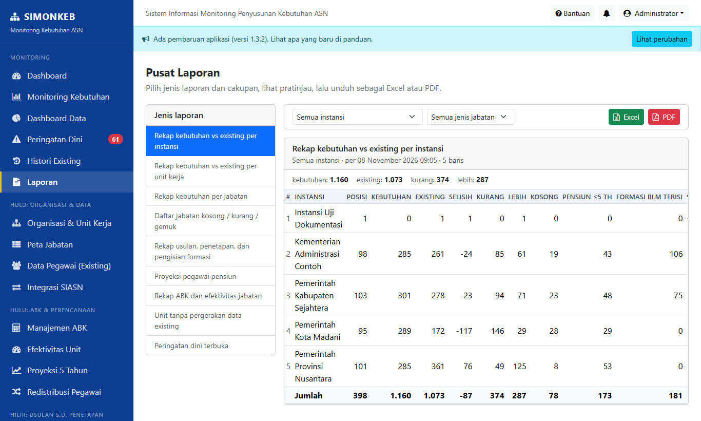


---

## G. Administrasi & pendukung

Manajemen pengguna, akun pribadi, notifikasi, audit, panduan.

**Hubungan dengan tahap sebelumnya:** Pengelolaan pengguna dan fitur pendukung yang menopang seluruh tahap sebelumnya.

### 46. Tambah pengguna

- **Akun:** `admin` (admin@simonkeb.test)
- **Fungsi:** Admin membuat akun dengan peran dan (untuk operator) instansi.
- **Hasil yang diharapkan:** Pengguna baru tampil di daftar.

**Langkah (berurutan):**

> **Posisi dalam alur:** Tahap 1 dari 8 pada bagian G. Dilanjutkan dari skenario 45. Laporan: seluruh jenis (Excel + PDF). Setelah ini: skenario 47. Hapus pengguna (dialog konfirmasi).

1. Pertama, menu **Pengguna** → **Tambah**.
2. Kemudian, isi Nama `Operator Uji`, Email `operator-uji@simonkeb.test`, Password, Peran *Operator Instansi*, pilih Instansi uji.
3. Terakhir, simpan.

**Hasil pengujian:** ✅ LULUS — Pengguna tersimpan.

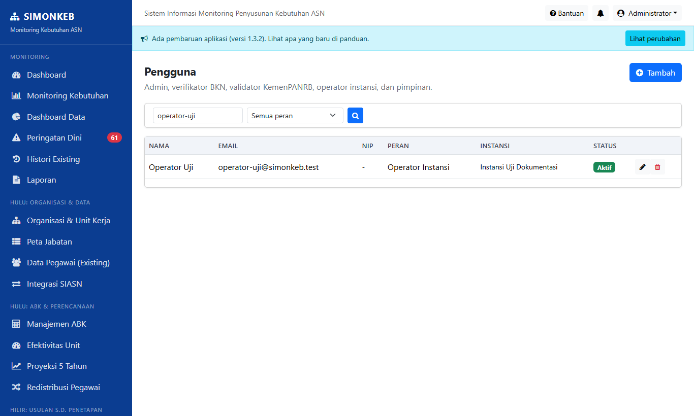

### 47. Hapus pengguna (dialog konfirmasi)

- **Akun:** `admin` (admin@simonkeb.test)
- **Fungsi:** Penghapusan selalu lewat dialog konfirmasi SweetAlert.
- **Hasil yang diharapkan:** Pengguna hilang dari daftar.

**Langkah (berurutan):**

> **Posisi dalam alur:** Tahap 2 dari 8 pada bagian G. Dilanjutkan dari skenario 46. Tambah pengguna. Setelah ini: skenario 48. Akun pribadi: ganti password & 2FA.

1. Pertama, cari `operator-uji`.
2. Terakhir, klik ikon tempat sampah dan konfirmasi.

**Hasil pengujian:** ✅ LULUS — Pengguna terhapus.

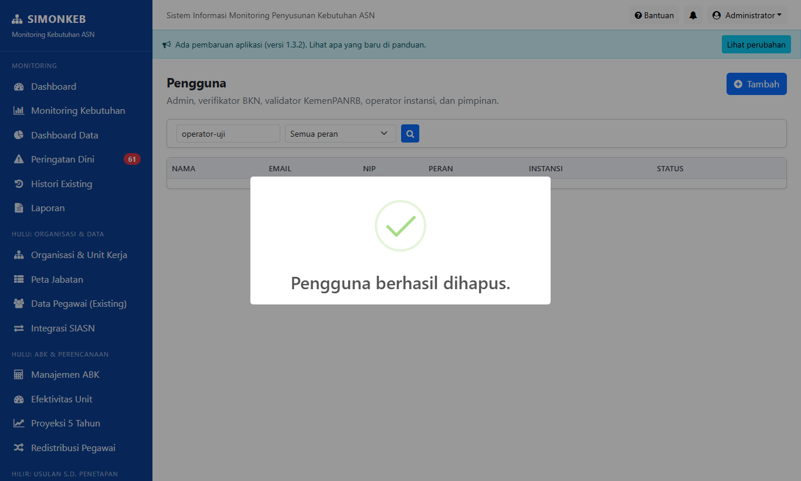

### 48. Akun pribadi: ganti password & 2FA

- **Akun:** `admin` (admin@simonkeb.test)
- **Fungsi:** Pengguna mengganti password sendiri dan mengaktifkan autentikasi dua langkah.
- **Hasil yang diharapkan:** Halaman tampil; password lama salah ditolak.

**Langkah (berurutan):**

> **Posisi dalam alur:** Tahap 3 dari 8 pada bagian G. Dilanjutkan dari skenario 47. Hapus pengguna (dialog konfirmasi). Setelah ini: skenario 49. Notifikasi.

1. Pertama, klik nama pengguna → **Akun**.
2. Terakhir, coba ganti password dengan password lama salah.

**Hasil pengujian:** ✅ LULUS — Password lama salah ditolak.

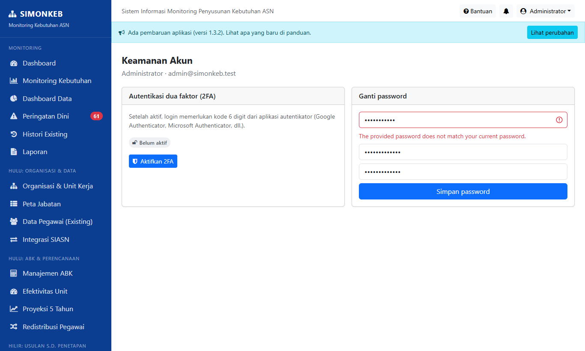

### 49. Notifikasi

- **Akun:** `bkn` (bkn@simonkeb.test)
- **Fungsi:** Pemberitahuan perubahan status usulan untuk peran terkait.
- **Hasil yang diharapkan:** Daftar tampil; semua tertandai dibaca.

**Langkah (berurutan):**

> **Posisi dalam alur:** Tahap 4 dari 8 pada bagian G. Dilanjutkan dari skenario 48. Akun pribadi: ganti password & 2FA. Setelah ini: skenario 50. Log audit.

1. Pertama, menu/ikon **Notifikasi**.
2. Terakhir, klik **Tandai semua dibaca**.

**Hasil pengujian:** ✅ LULUS — Notifikasi tampil.

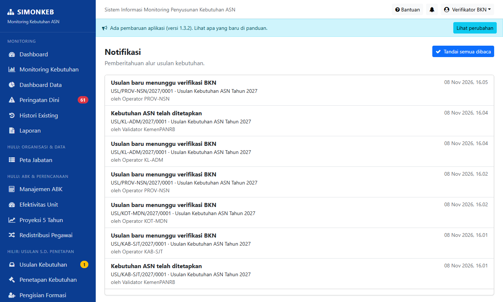

### 50. Log audit

- **Akun:** `admin` (admin@simonkeb.test)
- **Fungsi:** Jejak semua perubahan data (spatie/activitylog) — siapa, kapan, apa yang berubah.
- **Hasil yang diharapkan:** Memuat aktivitas pengujian di atas (tambah instansi, penetapan, dll.).

**Langkah (berurutan):**

> **Posisi dalam alur:** Tahap 5 dari 8 pada bagian G. Dilanjutkan dari skenario 49. Notifikasi. Setelah ini: skenario 51. Panduan pengguna dan unduh PDF.

1. Langkahnya: menu **Audit**.

**Hasil pengujian:** ✅ LULUS — 12 entri pada halaman pertama.

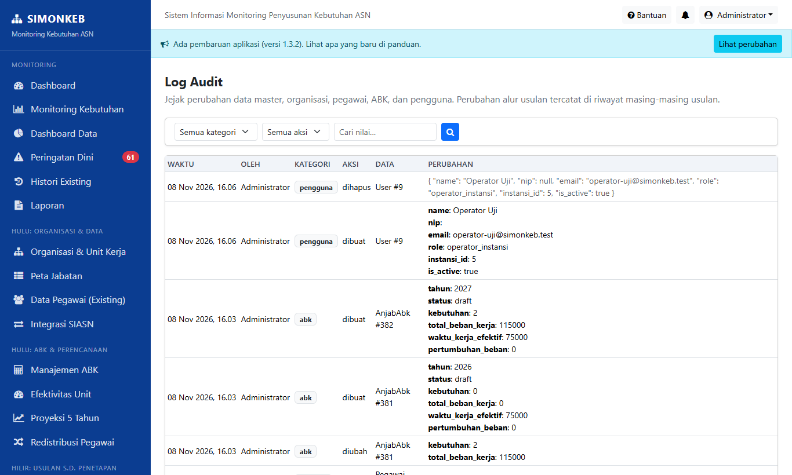

### 51. Panduan pengguna dan unduh PDF

- **Akun:** `admin` (admin@simonkeb.test)
- **Fungsi:** Panduan terintegrasi dalam aplikasi, dapat dicari dan diunduh PDF.
- **Hasil yang diharapkan:** Panduan tampil; PDF terunduh.

**Langkah (berurutan):**

> **Posisi dalam alur:** Tahap 6 dari 8 pada bagian G. Dilanjutkan dari skenario 50. Log audit. Setelah ini: skenario 52. Pedoman rumus ABK.

1. Pertama, klik **Bantuan** → **Panduan**.
2. Kemudian, cari kata `usulan`.
3. Terakhir, unduh PDF.

**Hasil pengujian:** ✅ LULUS — Panduan tampil. PDF: HTTP 200, application/pdf, 1.331.488 byte

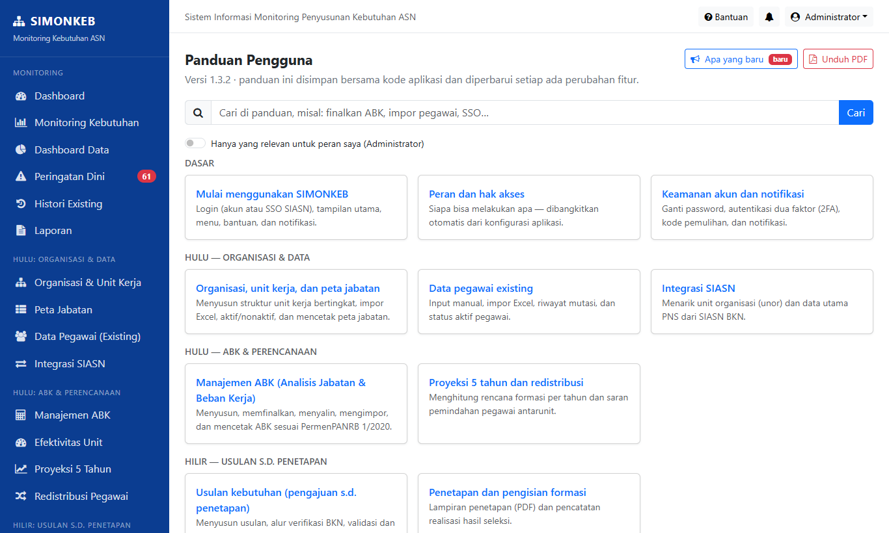

### 52. Pedoman rumus ABK

- **Akun:** `admin` (admin@simonkeb.test)
- **Fungsi:** Penjelasan konstanta dan rumus ABK.
- **Hasil yang diharapkan:** Halaman tampil.

**Langkah (berurutan):**

> **Posisi dalam alur:** Tahap 7 dari 8 pada bagian G. Dilanjutkan dari skenario 51. Panduan pengguna dan unduh PDF. Setelah ini: skenario 53. Hapus instansi: penjaga usulan dan pembersihan data uji.

1. Langkahnya: buka halaman **Pedoman**.

**Hasil pengujian:** ✅ LULUS — Pedoman tampil.

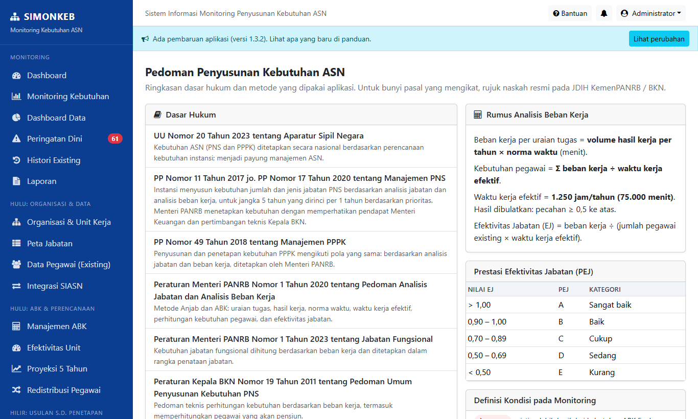

### 53. Hapus instansi: penjaga usulan dan pembersihan data uji

- **Akun:** `admin` (admin@simonkeb.test)
- **Fungsi:** Instansi yang sudah punya usulan tidak boleh dihapus (hanya dinonaktifkan). Instansi tanpa usulan dapat dihapus, dan unit/pegawai di bawahnya ikut terhapus (cascade).
- **Hasil yang diharapkan:** KL-ADM ditolak dengan pesan "tidak dapat dihapus, nonaktifkan saja". UJI-01 terhapus bersama unit dan pegawai ujinya.

**Langkah (berurutan):**

> **Posisi dalam alur:** Tahap 8 dari 8 pada bagian G. Dilanjutkan dari skenario 52. Pedoman rumus ABK. Setelah ini: skenario 54. Operator ditolak membuka menu khusus admin.

1. Pertama, buka **Instansi**, cari `KL-ADM` (sudah punya usulan) → klik ikon tempat sampah → konfirmasi.
2. Terakhir, cari `UJI-01` (data uji, tanpa usulan) → hapus → konfirmasi.

**Hasil pengujian:** ✅ LULUS — KL-ADM ditolak: "Instansi yang sudah memiliki usulan tidak dapat dihapus. Nonaktifkan saja.". UJI-01 terhapus: "Instansi berhasil dihapus.".

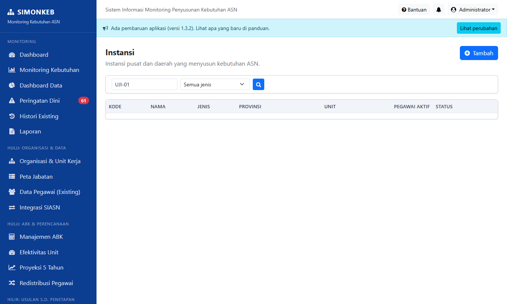


*Penolakan: instansi yang sudah punya usulan tidak dapat dihapus.*


---

## H. Penanganan error & hak akses

Jalur gagal yang sengaja dicoba: akses yang tidak berhak, tahapan yang dilompati, isian yang salah, berkas yang salah, serta penghapusan yang dilindungi. Aplikasi harus menolak dengan pesan yang jelas, tanpa merusak data.

**Hubungan dengan tahap sebelumnya:** Tahap penutup. Setelah seluruh jalur normal (A–G) terbukti, jalur gagal sengaja dicoba: akses tanpa hak, tahapan dilompati, isian dan berkas salah, serta penghapusan yang dilindungi. Tahap ini memakai data hasil tahap E dan G.

### 54. Operator ditolak membuka menu khusus admin

- **Akun:** `kab` (kab-sjt@simonkeb.test)
- **Fungsi:** Menu Pengguna, Audit, Instansi, dan Jabatan hanya untuk administrator. Mengetik alamatnya langsung tidak boleh menjadi jalan pintas.
- **Hasil yang diharapkan:** Setiap alamat menjawab 403 (dilarang) dan tidak menampilkan datanya.

**Langkah (berurutan):**

> **Posisi dalam alur:** Tahap 1 dari 17 pada bagian H. Dilanjutkan dari skenario 53. Hapus instansi: penjaga usulan dan pembersihan data uji. Setelah ini: skenario 55. Pimpinan (hanya baca) ditolak mengubah atau mengelola data.

1. Pertama, masuk sebagai operator Kabupaten.
2. Terakhir, ketik langsung alamat `/users`, `/audit`, `/instansi`, dan `/jabatan` di peramban.

**Hasil pengujian:** ✅ LULUS — /users=403, /audit=403, /instansi=403, /jabatan=403


*Halaman /users untuk operator: ditolak 403.*

### 55. Pimpinan (hanya baca) ditolak mengubah atau mengelola data

- **Akun:** `pimpinan` (pimpinan@simonkeb.test)
- **Fungsi:** Peran Pimpinan hanya melihat. Halaman kelola data dan pembuatan usulan harus tertutup.
- **Hasil yang diharapkan:** Semuanya menjawab 403.

**Langkah (berurutan):**

> **Posisi dalam alur:** Tahap 2 dari 17 pada bagian H. Dilanjutkan dari skenario 54. Operator ditolak membuka menu khusus admin. Setelah ini: skenario 56. Operator tidak dapat membuka usulan instansi lain.

1. Pertama, masuk sebagai Pimpinan.
2. Terakhir, ketik langsung `/pegawai`, `/unit-kerja`, `/siasn`, `/users`, dan `/usulan/create`.

**Hasil pengujian:** ✅ LULUS — /pegawai=403, /unit-kerja=403, /siasn=403, /users=403, /usulan/create=403


### 56. Operator tidak dapat membuka usulan instansi lain

- **Akun:** `kab` (kab-sjt@simonkeb.test)
- **Fungsi:** Operator dibatasi ke instansinya; usulan milik Provinsi dan Kementerian tidak boleh terbaca walau ID-nya ditebak.
- **Hasil yang diharapkan:** Ditolak (403) atau tidak ditemukan (404).

**Langkah (berurutan):**

> **Posisi dalam alur:** Tahap 3 dari 17 pada bagian H. Dilanjutkan dari skenario 55. Pimpinan (hanya baca) ditolak mengubah atau mengelola data. Setelah ini: skenario 57. Aksi alur kerja yang tidak sah ditolak server.

1. Pertama, masuk sebagai operator Kabupaten.
2. Terakhir, ketik langsung alamat usulan milik instansi lain: `/usulan/3` (Provinsi) dan `/usulan/4` (Kementerian).

**Hasil pengujian:** ✅ LULUS — /usulan/3=403, /usulan/4=403


*Usulan Provinsi dibuka operator Kabupaten: ditolak.*

### 57. Aksi alur kerja yang tidak sah ditolak server

- **Akun:** `kab` (kab-sjt@simonkeb.test)
- **Fungsi:** Server memeriksa peran dan status pada setiap aksi, bukan hanya menyembunyikan tombol di layar.
- **Hasil yang diharapkan:** Dua aksi pertama ditolak 422 dengan pesan status/peran tidak sesuai; aksi ke usulan lain ditolak 403.

**Langkah (berurutan):**

> **Posisi dalam alur:** Tahap 4 dari 17 pada bagian H. Dilanjutkan dari skenario 56. Operator tidak dapat membuka usulan instansi lain. Setelah ini: skenario 58. Tahapan tidak dapat dilompati.

1. Pertama, masuk sebagai operator Kabupaten, buka usulannya yang sudah ditetapkan (`/usulan/1`).
2. Kemudian, kirim langsung permintaan aksi **tetapkan** dan **ajukan** ke server (tanpa lewat tombol).
3. Terakhir, kirim aksi ke usulan milik instansi lain (`/usulan/3`).

**Hasil pengujian:** ✅ LULUS — tetapkan=422, ajukan=422, usulan lain=403.


*Tiga permintaan aksi yang tidak sah dan jawaban server.*

### 58. Tahapan tidak dapat dilompati

- **Akun:** `kemenpan` (kemenpan@simonkeb.test)
- **Fungsi:** Usulan harus melewati verifikasi BKN dan pertimbangan teknis sebelum divalidasi dan ditetapkan.
- **Hasil yang diharapkan:** Tombol Mulai Validasi dan Tetapkan Kebutuhan tidak tampil; aksi langsung ditolak 422.

**Langkah (berurutan):**

> **Posisi dalam alur:** Tahap 5 dari 17 pada bagian H. Dilanjutkan dari skenario 57. Aksi alur kerja yang tidak sah ditolak server. Setelah ini: skenario 59. Catatan wajib saat mengembalikan atau menolak usulan.

1. Pertama, masuk sebagai Validator Kemenpan, buka usulan yang masih berstatus *diajukan* (`/usulan/3`).
2. Kemudian, periksa tombol tindakan yang tersedia.
3. Terakhir, kirim langsung aksi **tetapkan** ke server.

**Hasil pengujian:** ✅ LULUS — Tombol terlarang: 0. Server menjawab 422: {"aksi":["Aksi \"Tetapkan Kebutuhan\" tidak dapat dilakukan pada status Diajukan Instansi."]}


*Aksi tetapkan pada usulan berstatus diajukan.*

### 59. Catatan wajib saat mengembalikan atau menolak usulan

- **Akun:** `bkn` (bkn@simonkeb.test)
- **Fungsi:** Alasan pengembalian/penolakan harus tertulis agar operator tahu apa yang diperbaiki.
- **Hasil yang diharapkan:** Dialog menolak dengan tulisan "Catatan wajib diisi"; server juga menolak 422; status tetap *verifikasi BKN*.

**Langkah (berurutan):**

> **Posisi dalam alur:** Tahap 6 dari 17 pada bagian H. Dilanjutkan dari skenario 58. Tahapan tidak dapat dilompati. Setelah ini: skenario 60. Rekomendasi melebihi jumlah diusulkan ditolak.

1. Pertama, masuk sebagai Verifikator BKN, buka `/usulan/3`, klik **Mulai Verifikasi** dan konfirmasi.
2. Kemudian, klik **Kembalikan untuk Perbaikan**, biarkan catatan kosong, lalu klik **Ya, lanjutkan**.
3. Terakhir, kirim juga aksi kembalikan dan tolak dengan catatan kosong langsung ke server.

**Hasil pengujian:** ✅ LULUS — Dialog: "Catatan wajib diisi". Server: 422/422. Status tetap Verifikasi BKN.


*Dialog menolak catatan kosong.*


*Server menolak catatan kosong.*

### 60. Rekomendasi melebihi jumlah diusulkan ditolak

- **Akun:** `bkn` (bkn@simonkeb.test)
- **Fungsi:** Jumlah rekomendasi BKN tidak boleh lebih besar daripada jumlah yang diusulkan instansi.
- **Hasil yang diharapkan:** Tidak ada perubahan; status tetap *verifikasi BKN* dan kolom ditandai salah.

**Langkah (berurutan):**

> **Posisi dalam alur:** Tahap 7 dari 17 pada bagian H. Dilanjutkan dari skenario 59. Catatan wajib saat mengembalikan atau menolak usulan. Setelah ini: skenario 61. Berkas SK selain PDF ditolak.

1. Pertama, masuk sebagai Verifikator BKN, buka `/usulan/3` (berstatus verifikasi).
2. Kemudian, pada kolom **Rekomendasi BKN** baris pertama isi `99999`.
3. Terakhir, klik **Beri Pertimbangan Teknis** dan konfirmasi.

**Hasil pengujian:** ✅ LULUS — Ditolak; status tetap Verifikasi BKN.


*Kolom rekomendasi ditandai salah setelah ditolak server.*

### 61. Berkas SK selain PDF ditolak

- **Akun:** `kemenpan` (kemenpan@simonkeb.test)
- **Fungsi:** Lampiran SK penetapan hanya boleh berupa PDF.
- **Hasil yang diharapkan:** Ditolak 422 dengan pesan berkas harus PDF; usulan tidak berubah.

**Langkah (berurutan):**

> **Posisi dalam alur:** Tahap 8 dari 17 pada bagian H. Dilanjutkan dari skenario 60. Rekomendasi melebihi jumlah diusulkan ditolak. Setelah ini: skenario 62. Usulan tanpa rincian jabatan tidak dapat diajukan.

1. Pertama, masuk sebagai Validator Kemenpan.
2. Terakhir, kirim aksi **tetapkan** dengan berkas `sk.txt` (bukan PDF) langsung ke server.

**Hasil pengujian:** ✅ LULUS — Ditolak 422: {"file_sk":["Berkas SK harus berupa berkas bertipe: pdf."]}


*Berkas SK .txt ditolak.*

### 62. Usulan tanpa rincian jabatan tidak dapat diajukan

- **Akun:** `kab` (kab-sjt@simonkeb.test)
- **Fungsi:** Usulan kosong tidak boleh masuk antrean verifikasi.
- **Hasil yang diharapkan:** Pengajuan ditolak dan status tetap *Draft*.

**Langkah (berurutan):**

> **Posisi dalam alur:** Tahap 9 dari 17 pada bagian H. Dilanjutkan dari skenario 61. Berkas SK selain PDF ditolak. Setelah ini: skenario 63. Usulan yang sudah ditetapkan terkunci.

1. Pertama, menu **Usulan** → **Buat Usulan**, isi Tahun 2029 dan Perihal `Usulan Kosong Uji`, simpan.
2. Terakhir, tanpa mengisi rincian, klik **Ajukan Usulan** dan konfirmasi.

**Hasil pengujian:** ✅ LULUS — Ditolak; status tetap Draft.


*Pengajuan ditolak; usulan masih Draft.*

### 63. Usulan yang sudah ditetapkan terkunci

- **Akun:** `kl` (kl-adm@simonkeb.test)
- **Fungsi:** Setelah diproses, usulan tidak boleh diubah atau dihapus operator.
- **Hasil yang diharapkan:** Tombol ubah tidak tampil; hapus ditolak (hanya draft yang dapat dihapus).

**Langkah (berurutan):**

> **Posisi dalam alur:** Tahap 10 dari 17 pada bagian H. Dilanjutkan dari skenario 62. Usulan tanpa rincian jabatan tidak dapat diajukan. Setelah ini: skenario 64. Impor pegawai: berkas salah tipe dan baris tidak valid.

1. Pertama, masuk sebagai operator Kementerian, buka usulan yang sudah ditetapkan (`/usulan/4`).
2. Kemudian, periksa tombol ubah rincian, ajukan, dan tarik dari ABK.
3. Terakhir, kirim langsung permintaan hapus usulan ke server.

**Hasil pengujian:** ✅ LULUS — Tombol ubah: 0. Hapus ditolak 403.


*Hapus usulan yang sudah ditetapkan.*

### 64. Impor pegawai: berkas salah tipe dan baris tidak valid

- **Akun:** `admin` (admin@simonkeb.test)
- **Fungsi:** Impor Excel harus menolak tipe berkas yang salah dan melaporkan baris yang gagal tanpa menambah data rusak.
- **Hasil yang diharapkan:** Berkas .txt ditolak dengan pesan tipe berkas; CSV menghasilkan peringatan "baris gagal" beserta daftar alasan.

**Langkah (berurutan):**

> **Posisi dalam alur:** Tahap 11 dari 17 pada bagian H. Dilanjutkan dari skenario 63. Usulan yang sudah ditetapkan terkunci. Setelah ini: skenario 65. Isian wajib dikosongkan: pesan Bahasa Indonesia.

1. Pertama, menu **Pegawai** → **Impor**, pilih instansi Kabupaten Sejahtera.
2. Kemudian, unggah berkas `salah.txt` lalu klik **Impor**.
3. Terakhir, unggah berkas CSV berisi dua baris dengan NIP dan kode unit yang tidak valid, lalu klik **Impor**.

**Hasil pengujian:** ✅ LULUS — .txt ditolak. CSV: ×!Impor selesai: 0 ditambahkan, 0 diperbarui. 2 baris gagal.OKNoCancel.


*Berkas .txt ditolak.*

### 65. Isian wajib dikosongkan: pesan Bahasa Indonesia

- **Akun:** `admin` (admin@simonkeb.test)
- **Fungsi:** Form menolak isian kosong dengan pesan yang jelas di dekat kolomnya.
- **Hasil yang diharapkan:** Muncul pesan "wajib diisi" (Bahasa Indonesia) dan data tidak tersimpan.

**Langkah (berurutan):**

> **Posisi dalam alur:** Tahap 12 dari 17 pada bagian H. Dilanjutkan dari skenario 64. Impor pegawai: berkas salah tipe dan baris tidak valid. Setelah ini: skenario 66. Unit kerja yang masih berisi tidak dapat dihapus.

1. Pertama, buka form **Tambah Unit Kerja** (instansi Kabupaten sudah terisi), kosongkan nama, klik **Simpan**.
2. Terakhir, buka form **Tambah Pegawai**, biarkan semua kosong, klik **Simpan**.

**Hasil pengujian:** ✅ LULUS — Kedua form menolak isian kosong dengan pesan "wajib diisi".


*Form unit kerja kosong ditolak.*

### 66. Unit kerja yang masih berisi tidak dapat dihapus

- **Akun:** `admin` (admin@simonkeb.test)
- **Fungsi:** Unit yang masih punya sub-unit atau pegawai dilindungi dari penghapusan.
- **Hasil yang diharapkan:** Penghapusan ditolak dengan pesan "masih memiliki pegawai atau sub-unit"; unit tetap ada.

**Langkah (berurutan):**

> **Posisi dalam alur:** Tahap 13 dari 17 pada bagian H. Dilanjutkan dari skenario 65. Isian wajib dikosongkan: pesan Bahasa Indonesia. Setelah ini: skenario 67. Administrator tidak dapat menghapus akunnya sendiri.

1. Pertama, menu **Organisasi & Unit Kerja**, filter instansi Kabupaten Sejahtera.
2. Terakhir, klik ikon tempat sampah pada unit pertama (unit tertinggi) dan konfirmasi.

**Hasil pengujian:** ✅ LULUS — Ditolak: "× Unit kerja masih memiliki pegawai atau sub-unit.OKNoCancel"


*Penghapusan unit yang masih berisi ditolak.*

### 67. Administrator tidak dapat menghapus akunnya sendiri

- **Akun:** `admin` (admin@simonkeb.test)
- **Fungsi:** Mencegah aplikasi kehilangan seluruh administrator karena salah hapus.
- **Hasil yang diharapkan:** Ditolak dengan pesan "Tidak dapat menghapus akun sendiri".

**Langkah (berurutan):**

> **Posisi dalam alur:** Tahap 14 dari 17 pada bagian H. Dilanjutkan dari skenario 66. Unit kerja yang masih berisi tidak dapat dihapus. Setelah ini: skenario 68. Lupa password: email tidak dikenal dan token tidak valid.

1. Pertama, menu **Pengguna**, cari baris `admin@simonkeb.test` (akun yang sedang dipakai).
2. Terakhir, klik ikon tempat sampah pada baris itu dan konfirmasi.

**Hasil pengujian:** ✅ LULUS — Ditolak: "× Tidak dapat menghapus akun sendiri.OKNoCancel"


*Penghapusan akun sendiri ditolak.*

### 68. Lupa password: email tidak dikenal dan token tidak valid

- **Akun:** `tamu` (belum login)
- **Fungsi:** Alur pemulihan password harus memberi pesan jelas dan menolak token palsu.
- **Hasil yang diharapkan:** Email tidak dikenal ditolak; email terdaftar menerima konfirmasi pengiriman; token palsu ditolak.

**Langkah (berurutan):**

> **Posisi dalam alur:** Tahap 15 dari 17 pada bagian H. Dilanjutkan dari skenario 67. Administrator tidak dapat menghapus akunnya sendiri. Setelah ini: skenario 69. Percobaan login berulang dibatasi.

1. Pertama, buka `/forgot-password`, isi email yang tidak terdaftar, klik **Kirim tautan reset**.
2. Kemudian, isi email terdaftar `admin@simonkeb.test` dan kirim.
3. Terakhir, buka `/reset-password/token-palsu?email=admin@simonkeb.test`, isi password baru dan konfirmasinya, klik **Simpan password**.

**Hasil pengujian:** ✅ LULUS — Email tidak dikenal ditolak, email terdaftar menerima konfirmasi, token palsu ditolak.


*Email tidak terdaftar ditolak.*

### 69. Percobaan login berulang dibatasi

- **Akun:** `tamu` (belum login)
- **Fungsi:** Perlindungan terhadap tebak password: setelah 5 kegagalan per menit, login dikunci sementara.
- **Hasil yang diharapkan:** Percobaan ke-6 ditolak dengan pesan "Terlalu banyak percobaan masuk".

**Langkah (berurutan):**

> **Posisi dalam alur:** Tahap 16 dari 17 pada bagian H. Dilanjutkan dari skenario 68. Lupa password: email tidak dikenal dan token tidak valid. Setelah ini: skenario 70. Alamat atau data yang tidak ada menjawab 404.

1. Pertama, buka `/login`.
2. Terakhir, coba masuk 6 kali berturut-turut dengan email `uji-throttle@simonkeb.test` (tidak terdaftar) dan password salah.

**Hasil pengujian:** ✅ LULUS — Percobaan ke-6 dibatasi.


*Percobaan ke-6 dibatasi.*

### 70. Alamat atau data yang tidak ada menjawab 404

- **Akun:** `admin` (admin@simonkeb.test)
- **Fungsi:** Alamat ngawur atau ID yang tidak ada harus menjawab 404, bukan galat server atau halaman kosong.
- **Hasil yang diharapkan:** Keduanya menjawab 404.

**Langkah (berurutan):**

> **Posisi dalam alur:** Tahap 17 dari 17 pada bagian H. Dilanjutkan dari skenario 69. Percobaan login berulang dibatasi. Ini skenario terakhir.

1. Pertama, masuk sebagai admin.
2. Terakhir, buka `/usulan/999999` dan `/rute-yang-tidak-ada`.

**Hasil pengujian:** ✅ LULUS — /usulan/999999=404, /rute-yang-tidak-ada=404.


*Usulan dengan ID yang tidak ada.*

